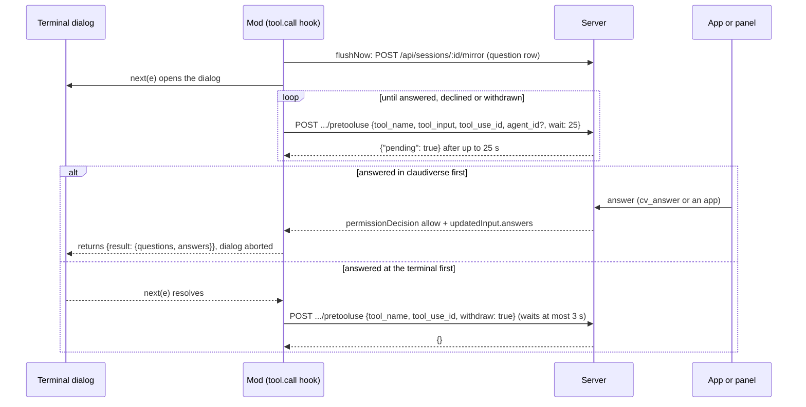
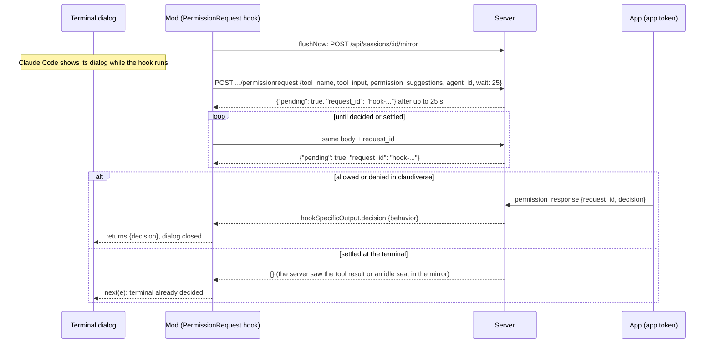

# Questions and permission relay

When Claude Code asks a question (the `AskUserQuestion` tool) or shows a permission prompt, the person may be away from the terminal. The claudiverse-seat mod therefore relays both to the Claudiverse server, so the web panel and the apps can answer them. The terminal dialog is always shown as well: the first answer, at the terminal or in claudiverse, wins. A person sitting at the terminal is never locked out, and a seat nobody watches simply waits.

Both relays work by polling. The mod's `$.http.fetch` gives up on a request after 30 seconds, so every poll asks the server to wait at most 25 seconds (`wait: 25`) and answer `{"pending": true}` if nothing has arrived.

## How it works

### Questions (`AskUserQuestion`)

The mod hooks `tool.call` for the `AskUserQuestion` tool. If the seat is not registered (no row on the server) or no server is configured, it calls `next(e)` and the terminal dialog decides alone. Otherwise:

1. It calls `flushNow`, which sends every pending mirror row at once. The question row must reach the server before the poll starts, or the apps would see a poll with no question to show.
2. It sets the status line to `claudiverse · <title> · question sent: answer here or in claudiverse`.
3. It calls `next(e)`, which opens the terminal dialog at once, and in parallel runs `answerRemotely`, which polls `POST /api/hooks/seat/<title>/pretooluse`.
4. `Promise.race` between the dialog and the poll decides. The status line returns to `claudiverse · <title>`.

The poll is a loop. Each reply is handled like this:

| Reply | Mod action |
| --- | --- |
| `{"pending": true}` | Poll again. |
| `permissionDecision` is `deny` | The hook returns `{deny: <permissionDecisionReason or "declined via claudiverse">}` as the tool result. |
| `permissionDecision` is `allow` and `updatedInput.answers` is set | The hook returns `{result: {questions, answers, annotations?}}`. Returning while `next` is pending aborts the terminal dialog; `annotations` is included only when the reply has it. |
| Anything else: `{}`, a non-OK status, a 4xx, an unparseable body | The remote side is out. The poll ends and the terminal dialog decides alone. |
| No reply, status 0, or status 500 or above (an outage) | Wait, then poll again (see below). |

If the person answers at the terminal first, the mod sets the poll's stop flag and sends a withdraw request (`tool_name`, `tool_use_id`, `withdraw: true`) so the apps stop offering the question. The mod waits for that request at most 3 seconds (`SERVER_WAIT_MS`) and ignores its failure. If the terminal dialog threw an error, the error is rethrown after the withdraw.

Outages: when a poll gets no reply, status 0, or status 500 or above, the mod waits 5 seconds (`RETRY_MS`), doubling on each consecutive failure up to 60 seconds (`POLL_RETRY_MAX_MS`), then polls again. A successful reply resets the counter. A question poll never gives up while the question is unanswered. This matters when the server restarts: the server holds pending questions in memory only, and the mod's next poll names the question again and reopens it.



### Permission prompts (`classic.PermissionRequest`)

The mod hooks `classic.PermissionRequest`. It does nothing (calls `next(e)`) if the seat is not registered, no server is configured, or the tool is `AskUserQuestion`. The question dialog is itself a permission prompt, but it is not relayed: its question is already relayed by the `tool.call` hook above, and relaying both made the apps show the question and an extra card asking to allow it.

Otherwise the mod calls `flushNow`, then `decideRemotely`, which polls `POST /api/hooks/seat/<title>/permissionrequest`. Claude Code shows its own dialog while the hook runs, and an answer returned later closes it.

- The first poll sends no `request_id`. The server mints one and replies `{"pending": true, "request_id": "<id>"}`. The mod keeps that id and sends it on every later poll.
- A reply with `hookSpecificOutput.decision.behavior` of `allow` or `deny` makes the hook return `{decision}`, which closes the terminal dialog.
- Any other reply (`{}`, a non-OK status, an unparseable body) returns null and the hook calls `next(e)`, so the terminal decides. The server replies `{}` when the seat has no running session, or when the prompt was settled or withdrawn.
- Outages (no reply, status 0, status 500 or above) are waited out with the same 5 s doubling to 60 s backoff, but only for 15 minutes (`PERMISSION_OUTAGE_MS`) counted from the start of the relay. After that the mod gives up and the terminal decides. The reason in the code: nothing here learns that the prompt was settled at the terminal while the server is unreachable, so it cannot wait for ever.



### Server side

Both endpoints are in the authenticated scope of `router.ex` and handled by `HookController` (`pretooluse` and `permission_request`). The caller is identified by its bearer token; `:seat` is the seat title.

Questions. A poll (`wait` a positive integer) registers the seat's `:question` link, then checks in with `QuestionHolds`, which tracks the question by `tool_use_id`. The poll waits for `min(wait * 1000, time left in the hold)` milliseconds. An answer that arrives between two polls is stashed by `QuestionHolds` and handed to the next poll. A question whose polls stop for 60 seconds is forgotten (the seat gave up or ended). The total life of a polled question is bounded by 24 hours (`question_poll_hold_ms`); past that the reply is `{}`. A newer poll for the same seat replaces an older one, and a `{}` reply goes to the replaced poll. The `withdraw` request closes the hold and tells the seat's link that the question was withdrawn. A `PreToolUse` request for any tool other than `AskUserQuestion` gets `{}`.

Permissions. The first poll enters the prompt into the seat's room as a `control_request` with `subtype` `can_use_tool` and `"hook": true`, so the web panel and apps show it. The `wait` is capped at 25 seconds on the server. A decision made between polls is kept by the room and handed over once to the poll that names the `request_id`. The room settles a prompt that was answered at the terminal from the mirror (the tool's result in the seat's next request, or the seat going idle), and the poll then returns `{}`.

Who may answer. Over the session channel, an `allow` in a `permission_response` is accepted only from a token whose context is `app` or `super` (`Accounts.app_powers?`); any other token gets the error `only the operator's app may allow a permission prompt`. A deny from any observer is accepted. This matches the web panel, which logs in with an `app` token, while a seat's or a runner's `api` token may watch and deny but not allow. This rule is on the permission path.

## Configuration

These are constants in `hooks/register.ts`, not settings.

| Name | Value | Meaning |
| --- | --- | --- |
| `QUESTION_POLL_S` | 25 | `wait` sent on every question and permission poll, in seconds. Under the 30 s limit of `$.http.fetch`. |
| `RETRY_MS` | 5000 | First backoff after an outage. Doubles per consecutive failure. |
| `POLL_RETRY_MAX_MS` | 60000 | Backoff ceiling. |
| `PERMISSION_OUTAGE_MS` | 900000 (15 min) | How long a permission poll waits out an outage before giving up. Questions have no such limit. |
| `SERVER_WAIT_MS` | 3000 | Longest the mod waits for the question withdraw request. |

The server holds are `question_poll_hold_ms` (24 hours), `question_hold_ms` and `permission_hold_ms` (59 minutes, used only by the single-request hold forms that omit `wait`; the mod always sends `wait`), and a 60 second staleness for question polls.

## Interface

All requests carry `Authorization: Bearer <seat token>` and `content-type: application/json`.

### `POST /api/hooks/seat/<title>/pretooluse`

Poll for an answer:

```json
{
  "tool_name": "AskUserQuestion",
  "tool_input": { "questions": [ { "question": "Which colour?", "header": "Colour", "options": [] } ] },
  "tool_use_id": "<tool use id>",
  "agent_id": "<only when a fork or subagent asks>",
  "wait": 25
}
```

Replies:

```json
{ "pending": true }
```

```json
{ "hookSpecificOutput": { "hookEventName": "PreToolUse", "permissionDecision": "allow",
  "permissionDecisionReason": "answered via claudiverse",
  "updatedInput": { "questions": [], "answers": { "<question text>": "<choice>" } } } }
```

```json
{ "hookSpecificOutput": { "hookEventName": "PreToolUse", "permissionDecision": "deny",
  "permissionDecisionReason": "declined via claudiverse" } }
```

`{}` means no opinion (replaced, withdrawn, past the hold, or another tool). How the server builds `answers`: an `answers` object is passed through; a `response` text made of `<header>: <choice>` lines, one per question, is split per question (a question without a line gets `(no answer given)`); other free text answers the first question, and the remaining questions point to it.

Withdraw:

```json
{ "tool_name": "AskUserQuestion", "tool_use_id": "<tool use id>", "withdraw": true }
```

Reply: `{}`.

### `POST /api/hooks/seat/<title>/permissionrequest`

```json
{
  "tool_name": "Bash",
  "tool_input": { "command": "ls", "description": "List files" },
  "permission_suggestions": [],
  "agent_id": "<only for a fork or subagent>",
  "wait": 25,
  "request_id": "<omitted on the first poll>"
}
```

Replies:

```json
{ "pending": true, "request_id": "hook-<random>" }
```

```json
{ "hookSpecificOutput": { "hookEventName": "PermissionRequest", "decision": { "behavior": "allow" } } }
```

```json
{ "hookSpecificOutput": { "hookEventName": "PermissionRequest",
  "decision": { "behavior": "deny", "message": "Denied from claudiverse" } } }
```

`{}` means the seat has no running session, or the prompt was settled or withdrawn; the terminal decides. The server also accepts `{"withdraw": true, "request_id": "..."}` here, but the mod does not send it (see below).

## Failure modes and troubleshooting

- The terminal shows the question but the apps do not. The question row reaches the server through `flushNow`, whose failure is swallowed. If the server was unreachable, the mod keeps polling and the next poll opens the question again once the server is back. The status line stays at `claudiverse · <title> · question sent: answer here or in claudiverse` while the question is open.
- The server restarted while a question was open. The mod polls through the outage with backoff (5 s to 60 s). The server forgot the question, and the next poll reopens it. An answer sent in between, for a question the server does not know yet, is kept by `tool_use_id` for 10 minutes and handed to the poll that names it.
- The server rejects the poll with a 4xx (for example a bad token). The remote side is dropped for that question or prompt and the terminal decides alone. Check the seat token.
- A permission prompt gives up after a long outage. After 15 minutes of failures the relay stops and the terminal dialog decides. Answer it at the terminal.
- An app cannot allow a prompt and shows `only the operator's app may allow a permission prompt`. The app is logged in with an `api` token; use an `app` token. Deny works with either.
- `AskUserQuestion` shows no allow card. This is intended: only the question is relayed.
- The seat has no row (`row == null`) or no configured server: neither hook relays anything and the terminal decides. See [registration](registration.md).

## Related pages

- [Overview](README.md)
- [Registration](registration.md)
- [Mirroring](mirroring.md)
- [Inbox](inbox.md)
- [Agents and background](agents-and-background.md)
- [Commands](commands.md)
- [Outages and session end](outages-and-session-end.md)
- [Configuration](configuration.md)
- [Server API](server-api.md)
- [Web panel: permissions and questions](../web/permissions-and-questions.md)
- Server: [Questions and permission relays](../../server/questions-and-permissions.md)
- Android: [Questions and permissions](https://github.com/Promises/claudiverse-apps/blob/main/docs/android/questions-and-permissions.md)
- Mac: [Questions and permissions](https://github.com/Promises/claudiverse-apps/blob/main/docs/mac/questions-and-permissions.md)

## Source

- `agent/mod/hooks/register.ts`
- `server/api/lib/claudiverse_server_web/router.ex`
- `server/api/lib/claudiverse_server_web/controllers/hook_controller.ex`
- `server/api/lib/claudiverse_server/question_holds.ex`
- `server/api/lib/claudiverse_server_web/channels/session_channel.ex`
- `server/api/lib/claudiverse_server/accounts.ex`
- `server/web/src/api/auth.ts`
