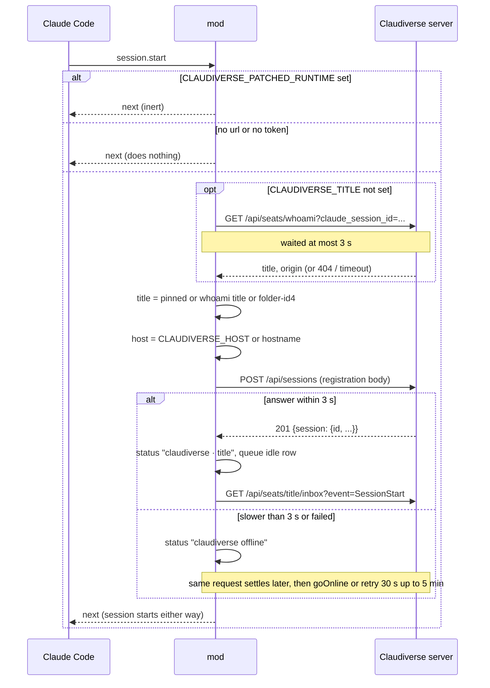

# Registration

Registration is the first thing the mod does: at `session.start` it works out a title for the Claude Code session, tells the Claudiverse server about it with `POST /api/sessions`, and, once the server has the seat, shows `claudiverse · <title>`, reports the seat idle and starts the inbox poll. It exists so that a stock Claude Code (2.1.287 or later, which has mods) becomes a seat on its own, with no patched binary, and so that a missing or slow server never stops Claude Code from starting.

## How it works

On `session.start` the mod decides in this order:

1. If `CLAUDIVERSE_PATCHED_RUNTIME` is set (non-empty), the mod does nothing. The patched runtime already connects the seat, and a second registration or mirror would duplicate it.
2. It resolves the server URL and the seat token. The launcher environment variables `CLAUDIVERSE_URL` and `CLAUDIVERSE_TOKEN` win over the plugin options `server_url` and `seat_token`. If either is missing, the mod does nothing and Claude Code runs as stock.
3. It derives the title:
   - If `CLAUDIVERSE_TITLE` is set, that is the title, and it is pinned: a later `/rename` does not move the seat.
   - Otherwise it asks the server for an existing seat of this Claude session id (`GET /api/seats/whoami?claude_session_id=<id>`), waiting at most 3 s (`SERVER_WAIT_MS`). If a seat answers with a title, that title is used. This keeps a plain `claude --resume` of a conversation that already has a seat under that seat's name.
   - Otherwise the title is `<folder>-<first 4 characters of the session id>`. `<folder>` is the last component of the working directory, with every run of characters outside `A-Za-z0-9._-` replaced by `-` (`seat` if the path has no components).
4. It reads `CLAUDIVERSE_HOST`, `CLAUDIVERSE_FLEET` and `CLAUDIVERSE_ORIGIN`. If no host is set, it runs `hostname` and uses its output.
5. It registers the `/claudiverse` command, then sends the registration request.

The request is idempotent by `claude_session_id`. The server reuses the row that already has this Claude session id (also a row that recorded it as its `conversation_id`), sets its status back to running, and applies the incoming title, working directory and the other fields. The same call is therefore safe to repeat: after an inbox outage, after a `/rename`, and after a server restart.

`origin` in the request body is chosen as follows:

| Situation | `origin` sent |
|---|---|
| `CLAUDIVERSE_ORIGIN` is set | its value |
| else the title is pinned by `CLAUDIVERSE_TITLE` | `"manual"` |
| else an existing seat was found by `whoami` | omitted (the server keeps the row's origin) |
| else | `"plain"` |

The mod reads the row id from the response as `id`, or else `session.id`. If neither is present the registration counts as failed.

Session start is never held up by the server. The registration request races a 3 s timer (`SERVER_WAIT_MS`):

- If the server answers within 3 s, the mod goes online.
- If not, the status line shows `claudiverse offline` and Claude Code carries on starting. The same request keeps running; when it settles, a success goes online, and a failure starts the retry loop. No second registration is sent alongside it.

Going online (`goOnline`) does three things: sets the status line to `claudiverse · <title>`, queues an `{"type":"idle"}` mirror row (the server reads it as "ready for a prompt"), and starts the first inbox poll with `event=SessionStart`.

Offline, the mod retries the registration after 30 s, doubling the wait after each failure up to 5 min (30 s, 60 s, 120 s, 240 s, 300 s, 300 s, ...). The first success goes online.



## Configuration

Plugin options (`userConfig` in `.claude-plugin/plugin.json`), set once per machine:

| Option | Meaning |
|---|---|
| `server_url` | Address of the server, for example `https://claudiverse.example`. A trailing `/` is removed. Empty keeps the machine's sessions out of Claudiverse. |
| `seat_token` | The token this machine's seats use. Marked `sensitive`. |

Launcher environment variables (a host agent starting a profile, or `cv-spawn`, sets these). Empty or whitespace-only values count as unset.

| Variable | Default | Effect |
|---|---|---|
| `CLAUDIVERSE_URL` | plugin `server_url` | Server URL. Wins over the option. |
| `CLAUDIVERSE_TOKEN` | plugin `seat_token` | Seat token. Wins over the option. |
| `CLAUDIVERSE_TITLE` | derived (see above) | Pins the title; sets origin `"manual"` unless `CLAUDIVERSE_ORIGIN` is set; makes `/rename` leave the seat alone. |
| `CLAUDIVERSE_HOST` | output of `hostname` | Machine name reported as `host`. |
| `CLAUDIVERSE_FLEET` | none | Fleet reported as `fleet`. |
| `CLAUDIVERSE_ORIGIN` | see the table above | Reported as `origin`. |
| `CLAUDIVERSE_PROFILE` | none | Reported as `profile_id`. |
| `CLAUDIVERSE_PROFILE_REVISION` | none | Reported as `profile_revision`. |
| `CLAUDIVERSE_TMUX` | none | Reported as `tmux_session`. |
| `CLAUDIVERSE_PATCHED_RUNTIME` | none | If set, the mod is inert. |

Timings (constants in `register.ts`, not configurable): `SERVER_WAIT_MS` 3 s per request at session start; registration retry 30 s, doubling to 5 min.

## Interface

### Existing-seat lookup

```
GET /api/seats/whoami?claude_session_id=<session id>
Authorization: Bearer <seat token>
```

The mod uses the response only when it is a success status with a non-empty string `title`, plus `origin` if present. Any other status, parse error or timeout means "no existing seat". The server (`SeatController.whoami`) looks up the caller's own seats, ignoring `proxy` seats, and prefers a running one, then the newest. A match returns:

```json
{
  "session_id": 42,
  "title": "lorem-w1",
  "role": "worker",
  "can_notify": false,
  "access": "basic",
  "fleet": "lorem-fleet",
  "origin": "runner",
  "profile_id": null
}
```

No match returns 404 `{"error": "no seat registered under that id yet"}`. The endpoint also accepts `title=` instead of `claude_session_id`, which the mod does not use.

### Registration

```
POST /api/sessions
Authorization: Bearer <seat token>
Content-Type: application/json
```

```json
{
  "title": "lorem-w1",
  "claude_session_id": "<Claude session id>",
  "working_directory": "/home/me/project",
  "client_version": "<version> (Claude Code) [claudiverse-mod]",
  "host": "my-laptop",
  "fleet": "lorem-fleet",
  "origin": "manual",
  "type": "sidecar",
  "profile_id": "7",
  "profile_revision": "3",
  "tmux_session": "lorem-w1"
}
```

`host`, `fleet`, `origin`, `profile_id`, `profile_revision` and `tmux_session` are omitted when unset. The profile values are sent as the strings read from the environment.

The server (`SessionController.create`) answers 201 with the serialized row under `session`:

```json
{ "session": { "id": 42, "title": "lorem-w1", "type": "sidecar", "status": "running", "origin": "manual", "claude_session_id": "<Claude session id>" } }
```

(only some fields shown). A failed validation is 422 `{"errors": ...}`. What the server does with the body, as read from the code:

- `type` is always stored as `sidecar`; `status` is set to `running`.
- `claude_session_id` makes the call idempotent: an existing row for that user with this id (or this `conversation_id`) is updated instead of a new one inserted.
- `host`, `fleet`, `origin`, `working_directory`, `client_version` and `tmux_session` are applied only when a non-empty string; absence means "no news", so a re-POST without `origin` keeps the stored one.
- `profile_id` and `profile_revision` are parsed as integers. If the profile exists for this user, the server overrides `origin` with `"profile"` and takes `fleet` and `can_notify` from the profile. If it does not exist, both profile fields are dropped.
- Origin `"plain"` gets worker role and basic tool access by default, and does not page the operator (`can_notify` false) until the operator switches it on in the apps. The operator can grant more.
- The server also places the seat on a host by the caller's IP and starts the seat's room.

### Inbox, first poll

After going online: `GET /api/seats/<title>/inbox?wait=25&event=SessionStart`, plus `host`, `fleet` and `origin` query parameters when the mod has them. See [Inbox](inbox.md).

### Slash command

`/claudiverse` prints `claudiverse: seat <title> · session <id or "not registered"> · <url>`, with ` · host <host>` and ` · fleet <fleet>` appended when set.

## Failure modes and troubleshooting

| What you see | Cause and action |
|---|---|
| Nothing; no `claudiverse` status line, no seat | No URL or no token resolved, or `CLAUDIVERSE_PATCHED_RUNTIME` is set. Set the plugin options or the launcher variables. The mod then registers no `/claudiverse` command either (see [Commands](commands.md)). |
| Status line `claudiverse offline` at start | The server did not answer the registration within 3 s, or refused it. Claude Code works as stock. The mod retries at 30 s, doubling to 5 min, and goes online on the first success. Check the URL, the token and that the server is reachable. |
| Registration keeps failing with the server up | The mod needs a 2xx response with `id` or `session.id` in the JSON; a 401 (bad token) or 422 counts as failure with no message. Check the token. |
| Status line `claudiverse offline` later in the session | Two inbox polls failed in a row. When the server answers a poll again, the mod registers again (idempotent) and restores the status line. It does not send a new `idle` row; see [Outages and session end](outages-and-session-end.md). |
| Seat title is `<folder>-<4 characters>` although the conversation had a named seat | The `whoami` lookup took longer than 3 s or failed, so the derived name was used. Resume again when the server is reachable, or pin the title with `CLAUDIVERSE_TITLE`. |
| `/rename` does not move the seat | The title is pinned. The mod logs `claudiverse: the seat keeps its launch title <title> (CLAUDIVERSE_TITLE)`. |
| Two seats for one conversation | Seats are matched by `claude_session_id`; a different session id is a different seat. |

## Related pages

- [Mod overview](README.md)
- [Inbox](inbox.md)
- [Mirroring](mirroring.md)
- [Commands](commands.md)
- [Outages and session end](outages-and-session-end.md)
- [Configuration](configuration.md)
- [Server API](server-api.md)
- Server: [Sessions and Rooms](../../server/sessions-and-rooms.md)
- Runners and tools: [cv-spawn.sh: starting a seat](../../runners/cv-spawn.md)
- Host agent: [Starting seats](../../host-agent/starting-seats.md)

## Source

- `agent/mod/hooks/register.ts`
- `agent/mod/.claude-plugin/plugin.json`
- `agent/mod/hooks/hooks.json`
- `server/api/lib/claudiverse_server_web/router.ex`
- `server/api/lib/claudiverse_server_web/controllers/session_controller.ex`
- `server/api/lib/claudiverse_server_web/controllers/seat_controller.ex`
- `server/api/lib/claudiverse_server/sessions.ex`
- `server/api/lib/claudiverse_server/sessions/access.ex`
- `server/api/lib/claudiverse_server/profiles.ex`
