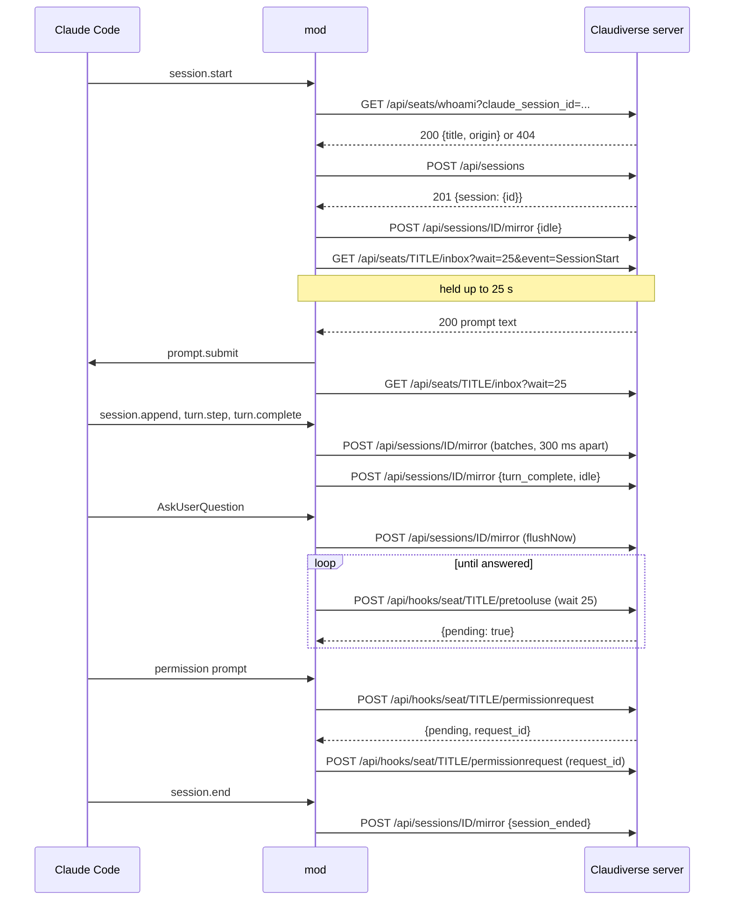

# Server API used by the mod

This page lists every call the `claudiverse-seat` mod makes to the Claudiverse server: six endpoints, seven request shapes. For each it gives the method, path, query or body, headers, the responses the mod handles and what it does with each, and a link to the page that explains the feature. It exists so that someone running or hosting a server can see exactly what a seat sends, and so that someone writing another client knows what the server accepts from a seat.

## How it works

All calls go through `$.http.fetch`, the HTTP function Claude Code gives a mod. It has no timeout of its own; the code comments say an unreachable host holds a request about 30 s, and that a long-poll is cut off at about 30 s whatever the server does (a keepalive written every 10 s did not extend it). The mod therefore keeps its own limits:

- The `whoami` lookup, the first registration, and the question withdraw are raced against `SERVER_WAIT_MS` (3 s). The request itself is not cancelled; the mod just stops waiting for it.
- Every long-poll asks the server to hold for at most 25 s (`wait=25` for the inbox, `"wait": 25` in the body of the question and permission polls), under the 30 s limit.
- Mirror POSTs are fire-and-forget: the response is not read and a failure is dropped.

Every call carries `Authorization: Bearer <seat token>`. Calls with a body also carry `content-type: application/json`. The `whoami` and inbox GETs carry only the `authorization` header. The base URL is the configured server address with any trailing `/` removed (see [configuration.md](configuration.md)). Path segments built from the seat title are URL-encoded.

### A typical session



## Configuration

The server address and token come from the plugin options or `CLAUDIVERSE_URL` and `CLAUDIVERSE_TOKEN`; the timing values named above are constants. See [configuration.md](configuration.md).

## Interface

### Summary

| Call | Method and path | When | Feature page |
|---|---|---|---|
| Seat lookup | `GET /api/seats/whoami?claude_session_id=<id>` | Session start, unless the title is pinned | [registration.md](registration.md) |
| Registration | `POST /api/sessions` | Session start; retry; after an inbox outage; after `/rename` | [registration.md](registration.md), [commands.md](commands.md) |
| Inbox poll | `GET /api/seats/<title>/inbox?wait=25[&event=&host=&fleet=&origin=]` | Continuously once online | [inbox.md](inbox.md) |
| Mirror | `POST /api/sessions/<id>/mirror` | Whenever rows are pending | [mirroring.md](mirroring.md), [agents-and-background.md](agents-and-background.md), [outages-and-session-end.md](outages-and-session-end.md) |
| Question poll | `POST /api/hooks/seat/<title>/pretooluse` | While an `AskUserQuestion` is open | [questions-and-permissions.md](questions-and-permissions.md) |
| Question withdraw | `POST /api/hooks/seat/<title>/pretooluse` with `withdraw: true` | A question was answered at the terminal | [questions-and-permissions.md](questions-and-permissions.md) |
| Permission poll | `POST /api/hooks/seat/<title>/permissionrequest` | While a permission prompt is open | [questions-and-permissions.md](questions-and-permissions.md) |

### GET /api/seats/whoami

Asks whether the server already has a seat for this Claude session id, so that a plain `claude --resume` keeps the seat's name.

```
GET https://claudiverse.example/api/seats/whoami?claude_session_id=<Claude session id>
Authorization: Bearer <seat token>
```

| Response | What the mod does |
|---|---|
| 2xx with JSON containing a non-empty string `title` | Uses that `title`, and `origin` if present, for this session. A seat found this way sends no `origin` in its registration. |
| Any other status (for example 404 `{"error": "no seat registered under that id yet"}`), a body that does not parse, a missing `title`, a network error, or no answer within 3 s | Treats it as "no existing seat" and derives the title. Nothing is logged. |

Example success body (the mod reads only `title` and `origin`):

```json
{ "session_id": 42, "title": "lorem-w1", "role": "worker", "can_notify": false, "access": "basic", "fleet": "lorem-fleet", "origin": "runner", "profile_id": null }
```

Not sent when `CLAUDIVERSE_TITLE` is set. Details: [registration.md](registration.md).

### POST /api/sessions

Registers the seat. Idempotent by `claude_session_id`: the server updates the row that has this id instead of adding one.

```
POST https://claudiverse.example/api/sessions
Authorization: Bearer <seat token>
content-type: application/json
```

```json
{
  "title": "lorem-w1",
  "claude_session_id": "<Claude session id>",
  "working_directory": "/home/me/project",
  "client_version": "<version> (Claude Code) [claudiverse-mod]",
  "host": "my-laptop",
  "fleet": "lorem-fleet",
  "origin": "manual",
  "type": "sidecar",
  "profile_id": "7",
  "profile_revision": "3",
  "tmux_session": "lorem-w1"
}
```

`host`, `fleet`, `origin`, `profile_id`, `profile_revision` and `tmux_session` are left out when unset (`JSON.stringify` drops undefined values).

| Response | What the mod does |
|---|---|
| 2xx with JSON holding `id`, or `session.id` | Stores the id as the seat's row; the seat is registered. At session start this goes online (status `claudiverse · <title>`, an `idle` row, the first inbox poll). After an outage or a `/rename` it keeps the seat online (a `/rename` also restarts the poll under the new title). |
| 2xx with no id in the body | Counts as failure. |
| Non-2xx (for example 401, 422), a body that does not parse, or a network error | Counts as failure, silently. At session start: status `claudiverse offline` and a retry after 30 s, doubling to 5 min. After an outage: the next inbox answer registers again. After `/rename`: the title stays changed locally, the status line is not updated and the poll is not restarted. |

At session start the request is raced against 3 s. If it has not answered by then, the status line shows `claudiverse offline`, and when the same request settles later a success goes online and a failure starts the retry loop; no second request is sent alongside it. The server's answer is 201 `{ "session": { "id": 42, ... } }`. Details: [registration.md](registration.md), [commands.md](commands.md), [outages-and-session-end.md](outages-and-session-end.md).

### GET /api/seats/&lt;title&gt;/inbox

Long-poll for remote input and interrupts.

```
GET https://claudiverse.example/api/seats/lorem-w1/inbox?wait=25&event=SessionStart&host=my-laptop&fleet=lorem-fleet&origin=manual
Authorization: Bearer <seat token>
```

Query: `wait` is always `25`. `event=SessionStart` is sent only on the first poll after the seat goes online. `host`, `fleet` and `origin` are sent when the seat has them.

| Response | What the mod does |
|---|---|
| 200 with a non-empty body | The body is one or more prompts. Plain text is submitted with `$.prompt.submit({ text, asUser: true })` (not awaited); `/compact` is run as a command; any other `/command` is refused with a log line. Then polls again. |
| 204 | Nothing arrived. Polls again. |
| 205 | The app's Interrupt. Calls `$.turn.abort` on the running main turn (or logs that no turn is known), then polls again. |
| 409 | Another poll took this seat over. Logs `claudiverse: another poller took this seat over; inbox stopped` and stops polling. |
| 200 with an empty body, any other status, or a network error | Failure: backs off 5 s doubling to 60 s. The status line becomes `claudiverse offline` on the second consecutive failure. The first good answer afterwards resets the counter, restores the status line and registers again. |

Details: [inbox.md](inbox.md).

### POST /api/sessions/&lt;id&gt;/mirror

Sends the conversation and control rows. `<id>` is the row id from registration. Nothing is sent while the seat has no id.

```
POST https://claudiverse.example/api/sessions/42/mirror
Authorization: Bearer <seat token>
content-type: application/json
```

```json
{ "messages": [ { "type": "idle" } ] }
```

At most 200 rows per request (`MAX_BATCH`); a longer queue goes out as several requests in a row. Rows are batched for 300 ms (`FLUSH_MS`), except when the mod drains the queue at once before holding on a question or a permission prompt, and at session end.

| Response | What the mod does |
|---|---|
| Any | The mod does not read the response. The server answers 202 `{ "ok": true, "count": 1 }`; a 400 (more than 200 rows, a row without a string `type`, `messages` not a list) or a 404 (not this user's session) is ignored. |
| Network error | Swallowed. The batch has already left the queue and is lost. |

Row types sent: `user`, `assistant`, `agent_message`, `stream_event`, `idle`, `turn_complete`, `compact`, `agent_turn_complete`, `agent_started`, `agents`, `agent_ended`, `background_tasks`, `session_ended`. Details: [mirroring.md](mirroring.md), [agents-and-background.md](agents-and-background.md), [outages-and-session-end.md](outages-and-session-end.md).

### POST /api/hooks/seat/&lt;title&gt;/pretooluse (question poll)

Offers an `AskUserQuestion` to the apps and waits for an answer. Repeated until a final answer, a refusal, or the terminal answers first.

```
POST https://claudiverse.example/api/hooks/seat/lorem-w1/pretooluse
Authorization: Bearer <seat token>
content-type: application/json
```

```json
{
  "tool_name": "AskUserQuestion",
  "tool_input": { "questions": [ { "question": "Which colour?", "header": "Colour", "options": [] } ] },
  "tool_use_id": "<tool use id>",
  "agent_id": "<only when a fork or subagent asks>",
  "wait": 25
}
```

| Response | What the mod does |
|---|---|
| 2xx, `{"pending": true}` | Polls again at once. |
| 2xx, `hookSpecificOutput.permissionDecision` `"deny"` | Ends the poll. The tool call returns a denial with `permissionDecisionReason`, or `declined via claudiverse` when there is none. The terminal dialog is aborted. |
| 2xx, `permissionDecision` `"allow"` with `updatedInput.answers` | Ends the poll. The tool call returns `{ questions, answers }` (plus `annotations` if present) as its result. The terminal dialog is aborted. |
| 2xx, anything else (`{}`, `allow` without `answers`), a 4xx, or a body that does not parse | The remote side is out for this question. The terminal dialog decides alone. |
| Network error, status 0, or status 500 and above | Outage: waits 5 s doubling to 60 s and polls again, with no upper limit on the number of tries while the question is open. |

Example final answer:

```json
{ "hookSpecificOutput": { "hookEventName": "PreToolUse", "permissionDecision": "allow",
  "updatedInput": { "questions": [], "answers": { "<question text>": "<choice>" } } } }
```

### POST /api/hooks/seat/&lt;title&gt;/pretooluse (withdraw)

Sent once when a question was answered at the terminal, so the apps stop offering it.

```json
{ "tool_name": "AskUserQuestion", "tool_use_id": "<tool use id>", "withdraw": true }
```

The mod waits at most 3 s (`SERVER_WAIT_MS`), ignores the response and ignores any failure. The server answers `{}`. Details for both pretooluse calls: [questions-and-permissions.md](questions-and-permissions.md).

### POST /api/hooks/seat/&lt;title&gt;/permissionrequest (permission poll)

Offers a permission prompt (any tool except `AskUserQuestion`) to the apps.

```
POST https://claudiverse.example/api/hooks/seat/lorem-w1/permissionrequest
Authorization: Bearer <seat token>
content-type: application/json
```

```json
{
  "tool_name": "Bash",
  "tool_input": { "command": "ls", "description": "List files" },
  "permission_suggestions": [],
  "agent_id": "<only for a fork or subagent>",
  "wait": 25,
  "request_id": "<omitted on the first poll>"
}
```

| Response | What the mod does |
|---|---|
| 2xx, `{"pending": true, "request_id": "<id>"}` | Keeps the `request_id` and polls again with it. |
| 2xx, `hookSpecificOutput.decision.behavior` `"allow"` or `"deny"` | Returns that `decision` from the hook; the terminal dialog closes. |
| 2xx, anything else (`{}`), a 4xx, or a body that does not parse | The terminal decides alone. |
| Network error, status 0, or status 500 and above | Outage: waits 5 s doubling to 60 s and polls again, but only until 15 minutes (`PERMISSION_OUTAGE_MS`) after the first poll started; after that the terminal decides alone. |

Example decisions:

```json
{ "hookSpecificOutput": { "hookEventName": "PermissionRequest", "decision": { "behavior": "allow" } } }
```

```json
{ "hookSpecificOutput": { "hookEventName": "PermissionRequest",
  "decision": { "behavior": "deny", "message": "Denied from claudiverse" } } }
```

The server also accepts `{"withdraw": true, "request_id": "..."}` on this path; the mod never sends it. Details: [questions-and-permissions.md](questions-and-permissions.md).

## Failure modes and troubleshooting

| What you see | Cause | What to do |
|---|---|---|
| `claudiverse offline` and no seat in the apps | Registration refused or unanswered. A bad token (401) is indistinguishable from an unreachable server in the mod, because it logs nothing. | Check the server address, the token and reachability; see [registration.md](registration.md). |
| Inbox keeps backing off though the server is up | Any status other than 200 with a body, 204, 205 or 409 is a failure, including a 401 from a rejected token. | Check the seat token. |
| Questions or permission prompts are not offered in the apps | The seat has no row id (never registered), or the polls get a 4xx. | Check the status line; a 4xx ends the remote side for that prompt. |
| Gaps in the apps' conversation | A mirror POST failed and the batch was dropped. | None; see [outages-and-session-end.md](outages-and-session-end.md). |

## Related pages

- [Mod overview](README.md)
- [Registration](registration.md)
- [Inbox](inbox.md)
- [Mirroring](mirroring.md)
- [Questions and permissions](questions-and-permissions.md)
- [Agents and background work](agents-and-background.md)
- [Commands](commands.md)
- [Outages and session end](outages-and-session-end.md)
- [Configuration](configuration.md)
- Server: [Sessions and Rooms](../../server/sessions-and-rooms.md)
- Runners and tools: [cv-spawn.sh: starting a seat](../../runners/cv-spawn.md)
- Host agent: [Starting seats](../../host-agent/starting-seats.md)

## Source

- `agent/mod/hooks/register.ts`
- `server/api/lib/claudiverse_server_web/router.ex`
- `server/api/lib/claudiverse_server_web/controllers/seat_controller.ex`
- `server/api/lib/claudiverse_server_web/controllers/session_controller.ex`
- `server/api/lib/claudiverse_server_web/controllers/inbox_controller.ex`
- `server/api/lib/claudiverse_server_web/controllers/hook_controller.ex`
