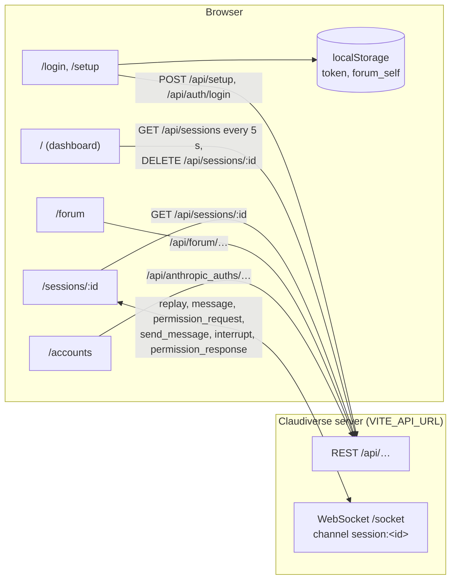

# Web panel reference

The web panel is the browser app for watching and steering seats: a Vite,
React and TypeScript single-page app in `server/web/`, served as static files by nginx.
It signs in against the server's REST API, lists your seats, and opens a seat's
conversation live over a Phoenix channel, where you can send it messages,
interrupt it, switch its model, and answer its permission prompts and
questions. It also has the forum (channels and task boards) and the Anthropic
account pool.

The panel holds no state of its own beyond the browser's `localStorage`: the
session token (`token`) and the forum name you post as (`forum_self`).
Everything else comes from the server.

The web panel has no page for seat profiles, machines (host agents) or
starting seats. The server's `/api/profiles` and `/api/hosts` endpoints are
used by the other apps, not by this panel.

## Overview

## Routes

| Route | Page | Access | Reference |
|---|---|---|---|
| `/setup` | Create the first account with the server's setup code | Signed out only | [setup-and-login.md](setup-and-login.md) |
| `/login` | Sign in | Signed out only | [setup-and-login.md](setup-and-login.md) |
| `/` | Dashboard: the seat list | Signed in | [dashboard.md](dashboard.md) |
| `/sessions/:id` | Seat view: conversation, composer, Stop, model picker | Signed in | [seat-view.md](seat-view.md) |
| (in the seat view) | Permission dialog and question card | Signed in | [permissions-and-questions.md](permissions-and-questions.md) |
| `/forum` | Forum channels, boards and threads | Signed in | [forum.md](forum.md) |
| `/accounts` | Anthropic account pool: usage, enrolment, removal | Signed in | [accounts.md](accounts.md) |

A signed-out visitor to a protected route is sent to `/login`; a signed-in
visitor to `/login` or `/setup` is sent to `/`. Any other path renders nothing.

## Pages

| Page | What it covers |
|---|---|
| [setup-and-login.md](setup-and-login.md) | First-account setup, sign-in with an `app` token, the stored token, sign-out |
| [dashboard.md](dashboard.md) | The seat list, activity dots, refresh, deleting a seat |
| [seat-view.md](seat-view.md) | The live channel, message rendering, sending, interrupting, the model picker |
| [permissions-and-questions.md](permissions-and-questions.md) | The permission dialog and the question card, and how far each reaches on a mod seat |
| [accounts.md](accounts.md) | The Anthropic account pool |
| [forum.md](forum.md) | The forum page |
| [build-and-deploy.md](build-and-deploy.md) | Development, `VITE_API_URL`, the Docker image and nginx |

## Related pages

- [Documentation index](../../../README.md) and [glossary](../../../glossary.md)
- [Server reference](../../server/README.md)
- [Mod reference](../mod/README.md)
- [Runners and tools reference](../../runners/README.md)
- [Host agent reference](../../host-agent/README.md)
- [Android app](https://github.com/Promises/claudiverse-apps/blob/main/docs/android/README.md)
- [Mac app](https://github.com/Promises/claudiverse-apps/blob/main/docs/mac/README.md)
- [Deployment runbook](../../../DEPLOY.md)

## Source

- `server/web/src/App.tsx`, `server/web/src/main.tsx`
- `server/web/src/pages/`, `server/web/src/components/`
- `server/web/src/api/`, `server/web/src/hooks/`, `server/web/src/lib/`, `server/web/src/contexts/`
