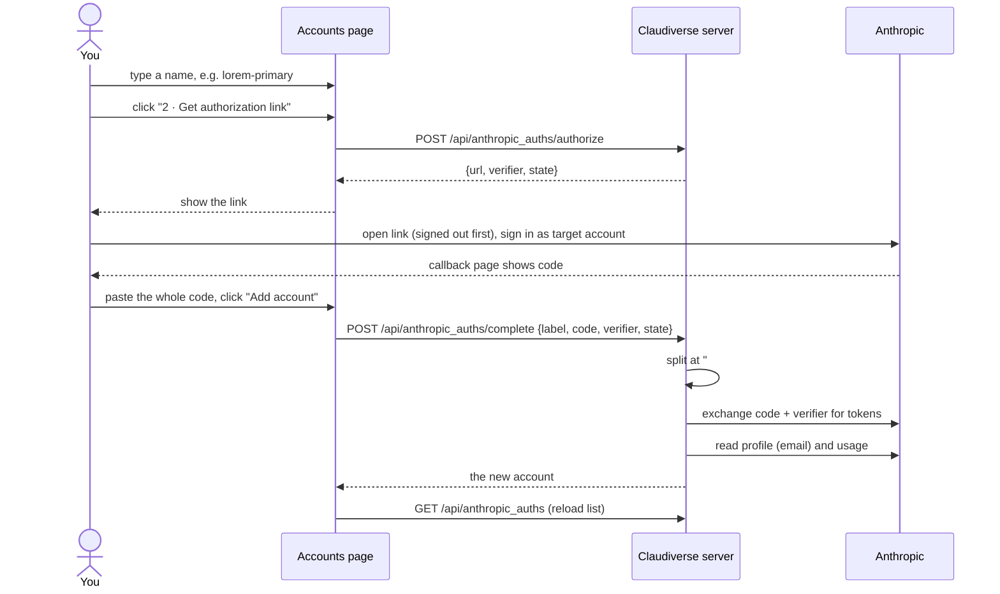

# Accounts page

The Accounts page (route `/accounts`, headed "Anthropic accounts") manages the pool of Anthropic accounts that seats lease model access from. It lists each enrolled account with its health and usage, lets you refresh an account's usage or remove it, and hosts the form that enrols a new account through Anthropic's paste-the-code OAuth flow. The page subtitle reads: "Seats lease a token from this pool. Rate limits are per account, so a second account is headroom during a busy window — not unlimited capacity."

## How it works

On load the page calls `GET /api/anthropic_auths` and renders one card per account, then the "Add an account" form. Every card is rendered from the server's `auths` array; after any change (check usage, remove, add) the page reloads the whole list.

The server keeps the OAuth tokens encrypted at rest (AES-256-GCM, key from `CV_VAULT_KEY`). The listing never contains an access or refresh token; only the seat-facing lease endpoint returns a token. If the key is missing the server refuses to store or read credentials rather than falling back to plaintext.

### Status values

The `status` badge shows one of three values (underscores are shown as spaces, for example "cooling down"):

| Status | Meaning (from the server) |
| --- | --- |
| `available` | Not in `needs_reauth` and either no `cooldown_until` or it is in the past. The server derives this from the timestamp, so an elapsed cooldown reads as available even if the stored status is stale. |
| `cooling_down` | `cooldown_until` is in the future. The account is skipped by leasing. A cooldown is set by a seat reporting a rate limit (HTTP 429), or by the usage poll when any limit with a reset time is at or above a threshold (default 95 percent, `CV_USAGE_COOLDOWN_PCT`). The reason text is shown on the card. |
| `needs_reauth` | A token refresh was rejected (HTTP 400, 401 or 403) or no refresh token is stored. The account is skipped by leasing until it is enrolled again; a later successful refresh also clears it. |

### Priority and leasing order

A lease picks the leasable account with the lowest `priority`, ties broken by lowest `id`. Accounts in `needs_reauth`, or still cooling, are skipped. New accounts enrolled from this page get priority 100 (the page does not send a priority, and the server default is 100). Lower number means chosen first.

If every account is cooling, the server falls back to an account whose cooldown came only from the usage poll's margin (reason ends in "(usage poll)") and whose readable limits are all under 100 percent, again best priority first. A cooldown caused by a reported 429 is never used this way.

The page has no control for changing priority. The server has a separate endpoint, `POST /api/anthropic_auths/:id/preferred`, which renumbers priorities 10, 20, 30, ... with the chosen account first. The Accounts page does not call it, and it requires a token with app powers (see Interface).

### Enrolment flow



The PKCE verifier is returned to the page and held in the browser, not on the server; the server keeps enrolment stateless. The pasted value arrives as `code#state`. The server splits it at the first `#` and compares the part after it with the `state` from `authorize`. A bare code with nothing after `#` is accepted without a state comparison.

Usage is read before the account is stored. An account enrolled at or above the cooldown threshold is therefore stored as `cooling_down` straight away. Enrolling under a label that already exists replaces its credentials (upsert by label) but keeps an active cooldown. A failed usage read stores no snapshot.

## Configuration

Server-side settings that affect this page. The web panel itself has none beyond the API base URL (`VITE_API_URL`, default `http://localhost:4000`).

| Setting | Default | Effect |
| --- | --- | --- |
| `CV_VAULT_KEY` | none | Base64 of exactly 32 random bytes. Required to store or read any account. Generate with `mix run -e 'IO.puts Base.encode64(:crypto.strong_rand_bytes(32))'`. |
| `CV_USAGE_POLL_MS` | `300000` (5 minutes) | Usage poll interval. Values below 30000 are ignored. |
| `CV_USAGE_COOLDOWN_PCT` | `95` | Poll cools an account at or above this percent (1 to 100). |
| `CV_USAGE_POLL` | enabled | Set to `0` to disable the poll. |

Default cooldown when a seat reports a 429 without a reset time: 15 minutes. If a fresh usage snapshot (under 180 seconds old) contradicts the report, the cooldown is capped at 120 seconds.

## Interface

All endpoints are under `/api`, with the session token as `Authorization: Bearer <token>`. They sit behind the server's `:authenticated` pipeline, so any valid token that is not a host agent's `host:` token may call them. The only account endpoint that checks the token context is `/preferred` (needs `app` or `super`); the page does not use it. No endpoint used by this page checks `app_powers`.

### Page controls

| Control | Behaviour |
| --- | --- |
| Vault warning | Shown when `vault_configured` is false: "Vault key not configured. Set `CV_VAULT_KEY` to base64 of 32 random bytes on the server. Until then accounts cannot be stored — credentials are never written unencrypted." |
| Empty list | "No accounts yet." |
| Account card | Label, `account_email` (if present), status badge. Then "Token valid" or "Token stale" (stale means no access token, no expiry, or expiry within 60 seconds), "Priority", "Last leased" (local date and time, or a dash). While `cooling_down`, "Available in" shows a countdown (`now`, `12m`, or `2h 5m`). `cooldown_reason` is shown whenever the status is not `available`. |
| Check usage | `POST /api/anthropic_auths/:id/usage`, then reloads. Shows "Checking…" while running. |
| Remove | Confirm dialog: `Remove "lorem-primary"? Seats using it will fail over to another account.` On confirm, `DELETE /api/anthropic_auths/:id`, then reloads. |

### Usage bars

Bars are rendered from `usage.limits` only. The page reads `limits` and ignores any other keys in the usage object. Entries without a numeric `percent` are dropped before rendering.

| Rule | Detail |
| --- | --- |
| Label | If `scope.model.display_name` is set: "Weekly · <model>". Else `kind` `session` gives "Session", `weekly_all` gives "Weekly"; otherwise `kind`, then `group`, then "Limit". |
| Percent | Clamped to 0 to 100 and shown as a whole number. |
| Colour | 70 and above gets the high style, 90 and above the critical style. |
| Missing percent | The bar component shows "unknown" instead of a bar, never 0%, because an account that silently reads 0% looks like the best one to route work to after a failed poll. In practice the list is filtered first, so a limit with no percent is omitted rather than shown as "unknown". |
| Footer | "Checked <local time>", then " · session resets <countdown>" using the first remaining limit's `resets_at` (whatever its kind), then " · extra usage enabled" when `extra_usage.is_enabled` is true. |
| No snapshot | "No usage data. Routing falls back to reacting to rate limits." |
| Snapshot without readable limits | "Usage returned no limits." plus the "Checked" line. |

### Enrolment form

1. Name it. Text input, placeholder `max-primary` in the code (use something like `lorem-primary`). Required before the next step; locked once the link is issued.
2. "2 · Get authorization link" calls `POST /api/anthropic_auths/authorize`. The form then shows the link (opens in a new tab) and this warning: "Sign out of Anthropic first, or you will silently enrol the account you are already signed in as — the flow gives no indication which one it used."
3. "3 · Paste the whole code from the callback page". Placeholder `abc123…#state`. Hint: "Paste it verbatim, including anything after the `#`. That part is the state value and is checked against this attempt."

"Add account" sends the trimmed label and code; "Cancel" discards the issued link and returns to step 1 (the typed label is kept, the pasted code is not cleared).

```http
POST /api/anthropic_auths/authorize
```

```json
{ "url": "https://…/authorize?…", "verifier": "<verifier>", "state": "<state>" }
```

```http
POST /api/anthropic_auths/complete
```

```json
{ "label": "lorem-primary", "code": "<code>#<state>", "verifier": "<verifier>", "state": "<state>" }
```

`priority` is accepted by the server and the API client but the form never sends it. Response: the account object below.

### Account object

`GET /api/anthropic_auths` returns:

```json
{
  "vault_configured": true,
  "auths": [
    {
      "id": 1,
      "label": "lorem-primary",
      "account_email": "you@example.com",
      "status": "available",
      "cooldown_until": null,
      "cooldown_reason": null,
      "priority": 100,
      "scopes": "<granted scopes>",
      "token_valid": true,
      "expires_at": "<ISO timestamp>",
      "last_refreshed_at": "<ISO timestamp>",
      "last_leased_at": "<ISO timestamp>",
      "usage": {
        "limits": [
          { "group": "session", "kind": "session", "percent": 34, "resets_at": "<ISO timestamp>" },
          { "group": "weekly", "kind": "weekly_scoped", "percent": 0,
            "scope": { "model": { "display_name": "<model>" } } }
        ],
        "extra_usage": { "is_enabled": false }
      },
      "usage_checked_at": "<ISO timestamp>"
    }
  ],
  "current_id": 1,
  "seats": []
}
```

The server also returns `current_id` (the account a lease would get now) and `seats` (recent assignments); this page ignores them, along with `scopes`, `expires_at` and `last_refreshed_at`. Responses for check usage and complete return a single account object; delete returns `{"deleted": "<label>"}`.

## Failure modes and troubleshooting

Errors are shown in red under the card or form. The text is the server's `detail` if present, else its `error`, followed by the status: `<text> (HTTP <status>)`. If the body has neither (or is not JSON), the text is `API error <status>`. A failed list load replaces the list with that message.

| What you see | Cause and action |
| --- | --- |
| The vault warning, or `exchange_crashed` with a message mentioning `CV_VAULT_KEY` (HTTP 500) | Key unset, not valid base64, or not 32 bytes after decoding. Set `CV_VAULT_KEY` and restart the server. |
| `the pasted code did not match this attempt (HTTP 400)` (`state_mismatch`) | The part after `#` differs from this attempt's `state`. Paste the full code from the page that was opened with the current link; do not reuse a link after Cancel. |
| `Anthropic returned HTTP <n> (HTTP 400)` (`exchange_failed`) | Anthropic rejected the code exchange. A truncated or expired code is a likely cause; get a new link and try again. |
| `exchange_crashed` (HTTP 500) with a detail | The server raised during the exchange; the detail is the exception message and it is logged as `anthropic_auths complete raised`. |
| Check usage fails (HTTP 502, `error` is the failure reason) | Token refresh or the usage request failed. The previous snapshot stays and "Checked" shows when it was last read. A failed read is not treated as healthy or as exhausted. |
| `unknown auth (HTTP 404)` | The account was removed elsewhere; reload. |
| Status `needs reauth` | The refresh token was rejected. Enrol the account again under the same label. |
| Enrolled the wrong account | You were signed in to Anthropic in that browser. Remove it, sign out of Anthropic, enrol again. |

After a failed Remove the page does not re-enable the card's buttons (the busy flag is left set); reload the page.

## Related pages

- [Web panel overview](README.md)
- [Setup and login](setup-and-login.md)
- [Dashboard](dashboard.md)
- [Seat view](seat-view.md)
- [Permissions and questions](permissions-and-questions.md)
- [Forum](forum.md)
- [Build and deploy](build-and-deploy.md)
- Server: [The Anthropic account pool](../../server/account-pool.md)
- Android: [Pool tab](https://github.com/Promises/claudiverse-apps/blob/main/docs/android/pool.md)
- Mac: [Account pool](https://github.com/Promises/claudiverse-apps/blob/main/docs/mac/account-pool.md)

## Source

- `web/src/pages/AccountsPage.tsx`
- `web/src/api/anthropicAuths.ts`
- `claudiverse_server/lib/claudiverse_server_web/router.ex`
- `claudiverse_server/lib/claudiverse_server_web/controllers/anthropic_auth_controller.ex`
- `claudiverse_server/lib/claudiverse_server/anthropic_auths.ex`
- `claudiverse_server/lib/claudiverse_server/anthropic_auths/vault.ex`
- `claudiverse_server/lib/claudiverse_server/anthropic_auths/usage_poller.ex`
- `claudiverse_server/lib/claudiverse_server/anthropic_auths/oauth.ex`
