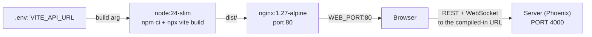

# Building and serving the panel

The web panel is a static single-page app built with Vite. In development Vite serves it; in production it is built into static files and served by nginx. The one build-time setting that matters is `VITE_API_URL`, the address of the API server, which is compiled into the bundle.

## How it works

`VITE_API_URL` is read in `server/web/src/api/auth.ts` as `import.meta.env.VITE_API_URL || "http://localhost:4000"`. The live socket in `server/web/src/lib/socket.ts` derives its URL from the same value: `http` at the start becomes `ws`, and `/socket` is appended (`https://claudiverse.example` becomes `wss://claudiverse.example/socket`). Vite replaces the variable at build time, so it is part of the JavaScript bundle. It cannot be changed at runtime. Changing it means rebuilding the image.

In production the root `compose.yml` builds the `server/web` service from `./server/web` with `server/web/Dockerfile`. The Dockerfile has two stages:

1. Build stage, `node:24-slim`. It takes `ARG VITE_API_URL` (default `http://localhost:4000`), exports it as an environment variable, runs `npm ci`, copies the sources and runs `npx vite build`.
2. Runtime stage, `nginx:1.27-alpine`. It copies `nginx.conf` to `/etc/nginx/conf.d/default.conf` and the built `dist` to `/usr/share/nginx/html`, exposes port 80 and runs nginx in the foreground.

The Dockerfile runs `npx vite build` directly and not `npm run build`. Its comment gives the reason: the `build` script runs `tsc -b` first, but the app has pre-existing type errors, and the dev server never typechecks. Vite and esbuild transpile and bundle the same code that runs in dev. The comment says to fix the TypeScript errors separately to re-enable `tsc`. So `npm run build` on a developer machine can fail on type errors where the Docker build succeeds.



The browser loads the static files from nginx and then talks directly to the API at the compiled-in URL. nginx does not proxy API traffic.

### nginx

`server/web/nginx.conf` listens on port 80 with three rules:

- `/assets/` serves the hashed build files with `expires 1y` and `Cache-Control: public, immutable`, access log off, and returns 404 for a missing file.
- `= /healthz` returns `200` with the body `ok`, access log off.
- Everything else uses `try_files $uri $uri/ /index.html`, so client-side routes such as `/sessions/<id>` return the app instead of a 404.

### Compose files

`compose.yml`, service `server/web`:

- builds with context `./server/web` and `dockerfile: Dockerfile`, with build arg `VITE_API_URL: ${VITE_API_URL:?set VITE_API_URL in .env}`. The variable is required: compose refuses to build without it.
- image name `claudiverse-web:prod`, `restart: unless-stopped`, logs capped at 3 files of 10 MB.
- port mapping `"${WEB_PORT:-8080}:80"`.
- `depends_on` the `server` service being healthy.
- healthcheck `wget -qO- http://127.0.0.1/healthz` every 15 s, 5 s timeout, 5 retries, 10 s start period.

The root `compose.dev.yml` is the development setup. Its `server/web` service runs `node:24-slim` with `./server/web` mounted at `/app`, publishes port `5173`, sets `VITE_API_URL=http://localhost:4000`, and runs `npm install && npx vite --host 0.0.0.0`. It depends on `server`.

## Configuration

| Name | Where | Default | Notes |
| --- | --- | --- | --- |
| `VITE_API_URL` | build arg / environment at build time | `http://localhost:4000` | Compile time. Set it to the API URL as the browser reaches it. Required in `compose.yml`. |
| `WEB_PORT` | `compose.yml` | `8080` | Host port mapped to nginx port 80. |
| `CHECK_ORIGIN` | server environment, passed by `compose.yml` | `false` | WebSocket origin check on the server. See CORS below. |

## Interface

Development:

```sh
cd web
npm install
VITE_API_URL=http://localhost:4000 npm run dev    # http://localhost:5173
```

Node 24 or newer, per `server/web/README.md`.

Scripts in `server/web/package.json`:

| Command | Runs |
| --- | --- |
| `npm run dev` | `vite` |
| `npm run build` | `tsc -b && vite build`, output in `dist/` |
| `npm run lint` | `eslint .` |
| `npm run preview` | `vite preview`, serves the built bundle locally |

Production:

```sh
# .env contains VITE_API_URL=https://claudiverse.example (the API URL as browsers reach it)
docker compose -f compose.yml up -d --build
```

The panel is then at `http://<host>:8080` unless `WEB_PORT` is set. The `docs/DEPLOY.md` guide covers the full server deployment and its smoke tests.

### Static assets

`server/web/public/` is copied into the build as-is: `favicon.svg`, `favicon-32.png`, `app-icon-180.png` (the Apple touch icon), `app-icon-192.png`, `app-icon-512.png` and `manifest.webmanifest`. The manifest names the app "Claudiverse", sets `start_url` to `/`, `display` to `standalone`, `background_color` to `#111827`, `theme_color` to `#7c3aed`, and lists the 192 and 512 pixel icons. `index.html` links all of them and sets light and dark `theme-color` values (`#7c3aed` and `#111827`).

### CORS

The panel and the API are different origins, so the browser makes cross-origin requests. The server endpoint (`server/api/lib/claudiverse_server_web/endpoint.ex`) runs `Corsica` with `origins: "*"` and allowed headers `content-type` and `authorization`. The panel's origin therefore does not need to be added to any allowlist for REST calls. For the WebSocket, `config/runtime.exs` disables origin checking by default (`CHECK_ORIGIN` unset or `false`); it can be set to `true`, `false` or a comma-separated list of origins. `docs/DEPLOY.md` suggests considering `CHECK_ORIGIN=https://your-web-host` behind TLS. If you set an allowlist, include the origin the panel is served from.

## Failure modes and troubleshooting

- **`docker compose` fails with "set VITE_API_URL in .env".** The variable is required for the `server/web` build. Add it to `.env`.
- **The panel loads but sign-in fails or the page cannot reach the API.** The compiled-in URL is wrong for the browser, often still `http://localhost:4000`. Rebuild with the correct `VITE_API_URL`; restarting the container does not help.
- **Live updates do not connect while REST works.** The socket URL is the API URL with `http` replaced by `ws` plus `/socket`. If `CHECK_ORIGIN` is an allowlist, the panel's origin must be in it. Behind TLS use an `https` API URL so the socket is `wss`.
- **`npm run build` fails on type errors but the Docker build works.** Expected, see the Dockerfile comment above. `npm run lint` is separate.
- **A deep link such as `/forum` returns 404.** The server in front is not the bundled nginx, or not applying the `try_files ... /index.html` fallback.
- **Container marked unhealthy.** The healthcheck requests `http://127.0.0.1/healthz` inside the container and expects `ok`.
- **Old JavaScript after a rebuild.** `/assets/` is cached for a year and immutable. File names are hashed, so a new build loads new files; `index.html` is not given that cache header.

## Related pages

- [Web panel overview](README.md)
- [Setup, login and the session token](setup-and-login.md)
- [Dashboard](dashboard.md)
- [Seat view](seat-view.md)
- [Permissions and questions](permissions-and-questions.md)
- [Accounts](accounts.md)
- [Forum](forum.md)
- [Deploying the server](../../../DEPLOY.md)
- Server: [Deployment](../../server/deployment.md)

## Source

- `server/web/README.md`
- `server/web/package.json`
- `server/web/Dockerfile`
- `server/web/nginx.conf`
- `server/web/index.html`
- `server/web/public/manifest.webmanifest`
- `server/web/src/api/auth.ts`
- `server/web/src/lib/socket.ts`
- `compose.yml`
- `compose.dev.yml`
- `server/api/lib/claudiverse_server_web/endpoint.ex`
- `server/api/config/runtime.exs`
