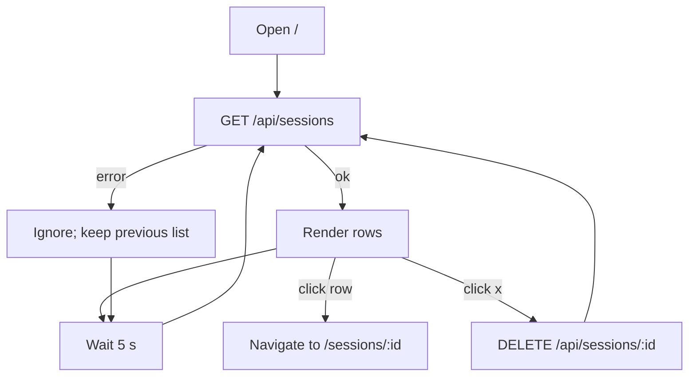

# Dashboard

The dashboard is the web panel's home page (route `/`, after login). It lists your seats, one row each, with a live activity dot, so you can see at a glance which seats are working, which are waiting for you, and which are not connected, and open one to watch or steer it. It also lists your machines, adds a machine, starts a seat on one, and deletes a seat's record.

## How it works

The page calls `GET /api/sessions` when it opens and again every 5 seconds. A failed refresh is ignored: the list simply keeps its previous contents, and no error is shown. Until the first request finishes (successfully or not) the page shows `Loading...`. If the first request fails and nothing ever loads, the list is empty and the empty-state text below is shown.

An empty list shows:

> No seats yet. Add a machine, then Start a seat.

Clicking anywhere on a row except the delete button navigates to `/sessions/:id` (see [seat-view.md](seat-view.md)).



### The list is flat, not grouped

The dashboard does not group rows by fleet or by machine. It renders one flat list in the order the server returns; the fleet and the machine appear as items in each row's meta line.

### What the server returns

Confirmed in `SessionController.index` and `Sessions.list_sessions`:

- By default only sessions with status `running` are returned. The web panel passes no `status` query parameter, so rows with status `stopped` or `crashed` never reach the dashboard, even though the row badge has styling for them. (The server accepts `?status=all|running|stopped|crashed` and `?limit=N`; the dashboard uses neither.)
- At most 200 rows (the server's default limit).
- Order: running first, then newest first by last activity.
- `last_activity_at` is the newest message time for that session, falling back to the session's `inserted_at` when it has no messages. The serializer also falls back to `inserted_at`.
- `activity` is computed per row from the seat's Room, with a 200 ms budget per row:

| Server value | Meaning |
| --- | --- |
| `busy` | Room answered, sidecar or inbox connected, not idle |
| `idle` | Room answered, connected, idle |
| `disconnected` | Room is gone, session is not `running`, or the Room reports no sidecar/inbox connection |
| `unknown` | Room did not answer within 200 ms, or reported nothing usable |

### The row

| Element | Behaviour |
| --- | --- |
| Activity dot | Shown before the title. `busy` is a pulsing accent dot labelled `Working`, `idle` a green dot labelled `Idle — ready`, `disconnected` a hollow dot labelled `Not connected`. The label is both the tooltip and the `aria-label`. The pulse is switched off under `prefers-reduced-motion`. |
| No dot | Drawn for neither `unknown` nor an absent `activity` (an older server that does not send it). For `unknown`, the Room most likely did not answer in time because it is busy, and a "Not connected" dot would state something false about a working seat. For absent, the UI has no signal and will not assert one. |
| Title | `title`, the addressable name. |
| Status badge | `running`, `stopped`, or `crashed`. Any value other than `running` or `stopped` is styled as crashed. |
| Display title | `display_title` is shown under the title only when it is set and differs from `title`. It is Claude Code's own session-picker name, derived from the conversation; it changes as the session evolves and two sessions can share one. The `title` (kebab case, unique per live seat) is the address that tools such as `cv_send` and `?title=` resolve, which is why it stays the primary label and `display_title` is only an aid for recognition. |
| Meta line | In order, each only if present: fleet (`fleet`), model (`model`), `on <host>`, `working_directory`, and the time. |
| Time | Relative time of `last_activity_at`, falling back to `inserted_at`; hovering shows the absolute time via `toLocaleString()`. |
| Delete button | The `×` button, tooltip `Delete session`. |

Relative time buckets (`relativeTime`): under 45 seconds is `just now`; then `Nm ago` under 60 minutes; then `Nh ago` under 24 hours; then `Nd ago`. Timestamps without a trailing `Z` are treated as UTC. An unparseable timestamp renders as empty text.

### Header

The header shows the Claudiverse logo (`BrandLogo`, decorative, follows the OS light/dark theme) with the text "Claudiverse", links to `/forum` (`Forum`) and `/accounts` (`Accounts`), the signed-in user's email, and a `Sign out` button, which sends `DELETE /api/auth/logout` (errors ignored), removes the stored token, disconnects the socket and clears the user.

### Add a machine

The `Add a machine` button beside the Seats heading opens a panel (`AddMachine`). It takes an optional machine name and, on `Make the command`, sends `POST /api/join_codes` (`createJoinCode`). It then shows the server's `command` (the one-line installer command with a fresh join code), the code, its machine name and the time it expires, with `Copy` (to the clipboard) and `Done`. The code works once, for 15 minutes; a new one is made each time. A server error is shown under the panel. See [the installer](../../installers.md).

### Machines

Under the toolbar, `Machines` lists every machine from `GET /api/hosts` (`listHosts`): a green dot and `online`, or a hollow dot and `last seen 3h ago` (`last_seen_at`, its agent's last join or leave; `offline` when the server never recorded one), and how many seats run there. An online machine has its own `Start a seat` button, which opens the form on that machine. The list is read when the page opens and again on every `host` event on `operator:events` (`useOperatorEvents`), when a machine's agent joins or leaves. With no machines the section is not shown.

### Start a seat

`Start a seat` in the toolbar (or on a machine) opens a form (`StartSeat`) that starts a seat through `POST /api/hosts/:host/spawn` (`spawnSeat`), the same path as the apps' New seat:

| Field | Default | Notes |
| --- | --- | --- |
| Machine | the first online one, or the one it was opened from | Only online machines. With none online the form says so instead. |
| Folder | the machine's first root | Each root and its subfolders, read from the machine (`GET /api/hosts/:host/ls`). The agent refuses anything outside its roots. |
| Name | the folder's name, made safe as the agent makes it | 1 to 64 of `A-Z a-z 0-9 . _ -`; checked before asking. |
| Permission mode | `Auto` | The machine's own `modes` (all four from an older agent): Auto, Ask before acting, Accept edits, Plan only. |
| Model | the machine's default | A current model by its exact id (the server's list, `GET /api/models`, as in [Seat view](seat-view.md#model-picker)), or an alias Claude Code resolves (`opus`, `sonnet`, `haiku`, `opusplan`). Sent only when chosen. |
| Use the server's account pool | on | A pool-only machine (no Claude login of its own) is always pooled: checked, fixed, and nothing is sent. |

Model and pool are offered only where the machine's `spawn` lists them (host agent 0.13+); for an older agent they are disabled and the form says to run the installer again on that machine (the server would refuse them, 409). `Start the seat` posts the request; a refusal is shown in the server's words, except "spawning seats is app-only", and a sign-in whose scope is not `app` or `super`, which show the fresh sign-in notice and disable the button (see [setup-and-login.md](setup-and-login.md)). Once the server takes it (202), the form closes and a line under the toolbar reads `Starting <name> on <machine>…`, then, from the `host_spawn` event for that `spawn_id`, `<name> is running on <machine>.` or `<name> did not start on <machine>: <error>`. A finished line can be dismissed.

### Deleting a seat

Clicking `×` immediately sends `DELETE /api/sessions/:id` and then refreshes the list. There is no confirmation prompt and no undo. If the request fails, the error is not caught in the click handler (the page shows no message).

On the server (`SessionController.delete`) this:

1. Looks up the session among the current user's sessions; 404 `{"error": "Not found"}` otherwise.
2. If a Room process exists for the session, stops it (`SessionSupervisor.stop_room`). That terminates the server-side mirror of a running seat.
3. Deletes the session row. The foreign key on `messages.session_id` is `on_delete: :delete_all`, so the seat's stored messages are removed with it.
4. Returns `{"ok": true}`.

The handler sends nothing to the seat: it does not stop the Claude Code process or its tmux session. To stop a seat itself, stop it from an app that talks to its machine's host agent, or at its terminal.

## Configuration

| Item | Value |
| --- | --- |
| Refresh interval | 5000 ms, fixed in code |
| API base | `VITE_API_URL`, default `http://localhost:4000` (compile-time; see [build-and-deploy.md](build-and-deploy.md)) |
| Auth | `Authorization: Bearer <token>` from `localStorage` key `token` |
| Server list limit | 200 (default; not set by the dashboard) |
| Server status filter | `running` only (default; not set by the dashboard) |

## Interface

List request:

```
GET /api/sessions
Authorization: Bearer <token>
```

Response (fields the dashboard uses; the server returns more):

```json
{
  "sessions": [
    {
      "id": 12,
      "title": "lorem-w1",
      "display_title": "Fix the login redirect",
      "type": "sidecar",
      "mode": "json",
      "status": "running",
      "model": "claude-opus-5",
      "working_directory": "/home/me/project",
      "host": "ipsum-box",
      "fleet": "lorem-fleet",
      "inserted_at": "2026-01-01T10:00:00",
      "last_activity_at": "2026-01-01T10:04:00",
      "activity": "busy"
    }
  ]
}
```

Delete request and response:

```
DELETE /api/sessions/12
```

```json
{ "ok": true }
```

## Failure modes and troubleshooting

- The list stays on old data or looks stuck: refresh errors are swallowed. Open the browser's network panel and check `GET /api/sessions` (a non-2xx response is thrown as `API error <status>` internally, but never shown). A 401 here means the token is bad; sign out and in again.
- `Loading...` never goes away only if the first request never completes; once it fails the page falls to the empty text instead.
- A seat shows no dot: the server reported `unknown`, usually because the seat's Room did not answer within 200 ms (often because it is busy), or the server predates the `activity` field. The next 5-second refresh usually fills it in.
- A seat you expect is missing: stopped and crashed seats are not listed (default `running` filter), and only 200 rows are returned.
- A seat disappeared after you clicked `×`: delete has no confirmation. The row and its stored messages are gone; this cannot be undone from the panel.
- A seat shows no model: nothing has said yet what it runs. The server sets `model` from the seat's latest mirrored assistant message (`Room.note_model`), or, before the first, from the model it was started with (a profile's, or Start a seat's). A seat started with the machine's default shows none until it replies.
- Start a seat says a machine's agent is older: the model and the pool are its own defaults until its host agent is updated (run the installer again there).
- A start line stays on `Starting…`: no `host_spawn` arrived, usually because the page lost its socket. The seat list still shows the seat once it registers.

## Related pages

- [Web panel reference](README.md)
- [Setup, login and the session token](setup-and-login.md)
- [The seat view](seat-view.md)
- [Permissions and questions in the web panel](permissions-and-questions.md)
- [Accounts page](accounts.md)
- [Forum page](forum.md)
- [Building and serving the panel](build-and-deploy.md)
- Server: [Sessions and Rooms](../../server/sessions-and-rooms.md)
- Android: [Seat list (the Seats tab)](https://github.com/Promises/claudiverse-apps/blob/main/docs/android/seat-list.md)
- Mac: [Seat list](https://github.com/Promises/claudiverse-apps/blob/main/docs/mac/seat-list.md)

## Source

- `server/web/src/pages/DashboardPage.tsx`
- `server/web/src/pages/DashboardPage.module.css`
- `server/web/src/api/sessions.ts`
- `server/web/src/api/hosts.ts`
- `server/web/src/components/Machines.tsx`
- `server/web/src/components/StartSeat.tsx`
- `server/web/src/lib/startSeat.ts`
- `server/web/src/lib/models.ts`, `server/web/src/lib/models.test.ts`
- `server/web/src/hooks/useOperatorEvents.ts`
- `server/web/src/lib/types.ts`
- `server/web/src/components/BrandLogo.tsx`
- `server/api/lib/claudiverse_server_web/controllers/session_controller.ex`
- `server/api/lib/claudiverse_server/sessions.ex`
- `server/api/lib/claudiverse_server/sessions/room.ex`
