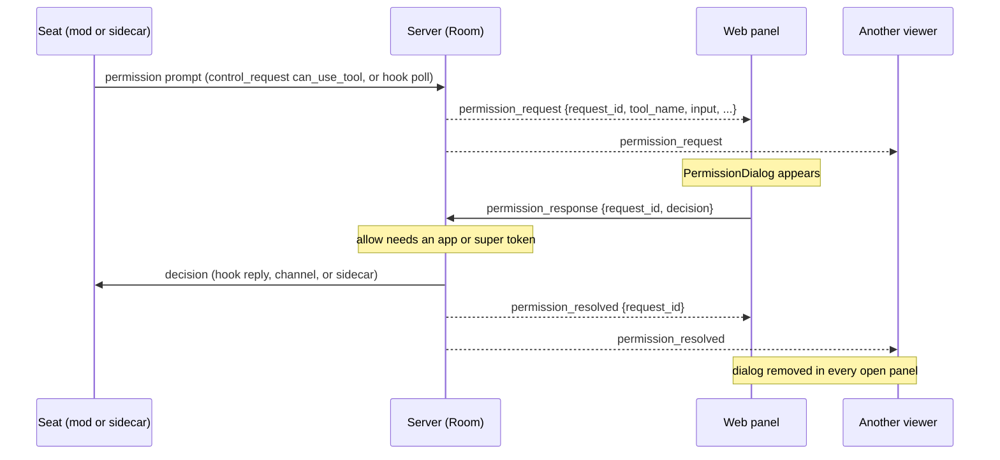
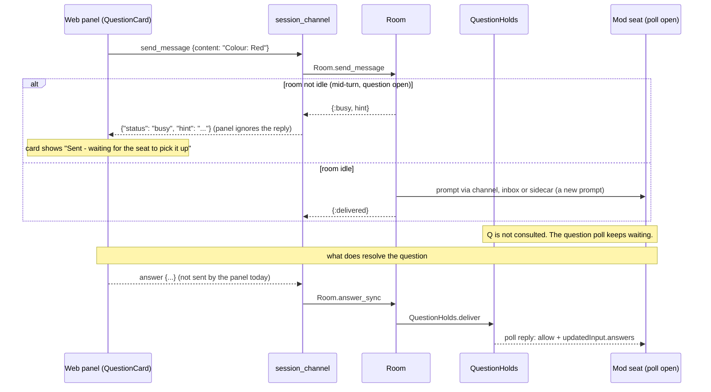
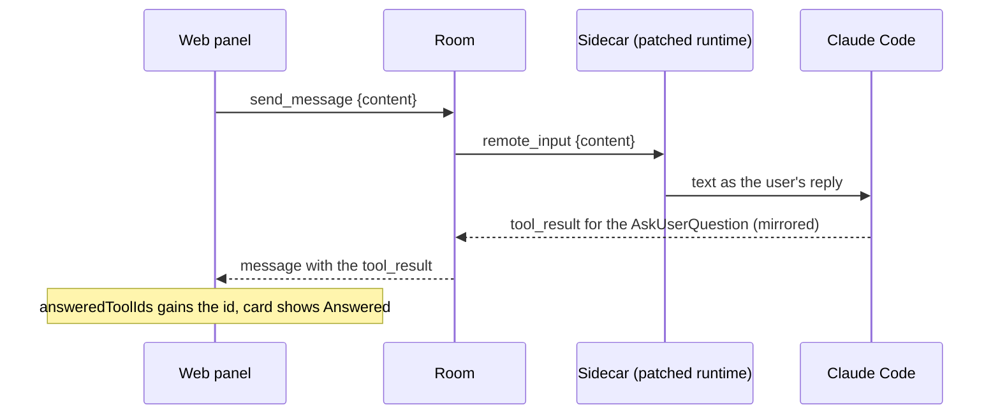

# Permissions and questions in the web panel

When a seat asks Claude Code's `AskUserQuestion` or shows a permission prompt, the seat view of the web panel shows both so you can answer from the browser. A permission prompt appears as a `PermissionDialog` with Allow and Deny buttons. A question appears as a `QuestionCard`, a picker drawn in place of the tool call in the conversation. This page describes what the panel does with each, and how far the answer gets on a seat that runs the `claudiverse-seat` mod. The mod's side is in [Questions and permission relay](../mod/questions-and-permissions.md).

## How it works

### Permission prompts

`useSession` joins the channel `session:<id>` as an observer and keeps a list `permissionRequests`:

- On `replay` it replaces the list with `payload.pending_permissions` (or `[]`). The server builds that field with `Room.get_pending_permissions`, so a prompt asked before you opened the page is still there. Prompts already decided (marked `decided` in the room) are left out.
- On `permission_request` it appends the request.
- On `permission_resolved` (`{request_id}`) it removes the request with that id.

`SessionPage` renders one `PermissionDialog` per entry, after the messages. The `PermissionRequest` type has these fields; the server also sends `agent_id` (the fork or subagent that asks, absent for main), which the panel's type does not declare and the dialog does not show.

| Field | Used for |
| --- | --- |
| `request_id` | Key, and the id sent back with the decision. |
| `tool_name` | Header, when `display_name` is empty. |
| `input` | Shown as JSON. |
| `display_name` | Header, preferred over `tool_name`. |
| `description` | Shown as a paragraph when present. |
| `title` | Declared in the type; the dialog does not render it. |

The dialog shows the header `Permission requested: <display_name or tool_name>`, the description if any, the `input` as `JSON.stringify(input, null, 2)`, then two buttons, Deny and Allow. Either one calls `respondToPermission(request_id, decision)`, which pushes:

```json
{ "request_id": "hook-AbC123", "decision": "allow" }
```

as the event `permission_response` (`decision` is `"allow"` or `"deny"`). The dialog does not remove itself and has no pending state. It disappears when the server broadcasts `permission_resolved` for that `request_id`. The server sends that broadcast when the decision is taken, and also when the prompt is settled some other way: answered at the seat's terminal, timed out, or the seat went away. So a prompt answered elsewhere, or by a second browser, vanishes from every open panel.

The login uses `scope: "app"` (`web/src/api/auth.ts`, for both `login` and `setup`). The server rule, in `session_channel.ex`, is that a `permission_response` with `"decision": "allow"` is accepted only when `Accounts.app_powers?` is true for the connection's token context (`app` or `super`). Any other token gets the channel reply `{"reason": "only the operator's app may allow a permission prompt"}`. A deny is accepted from any observer. The panel's push does not read the reply, so a refused allow shows nothing in the panel; the dialog simply stays. The panel's own token is an `app` token, so this only matters if you reuse a different token.



If the same prompt is answered at the terminal first, the server settles it (see the mod page) and sends `permission_resolved` without any `permission_response` from the panel.

### Questions

`MessageBubble` looks at each `tool_use` block of an assistant message. If `block.name === "AskUserQuestion"`, it calls `askedQuestions(block.input)`, which returns `input.questions` when that is a non-empty array of objects, and `null` otherwise. With a result it renders a `QuestionCard`; with `null` (an unknown or malformed shape) it falls through to the ordinary collapsed tool call showing the raw JSON. Nothing is guessed.

The card shows, per question, the `header`, the `question` text and one button per option (label, and the option `description` when present). A question with `multiSelect: true` toggles options; any other question keeps one pick. The card composes the answer as plain text (`compose`):

- One line per question that has a pick.
- The line is `<header>: <picks>` when there are several questions and the question has a `header`; otherwise just `<picks>`.
- Picks of a multi-select question are joined with `, `.

For example, two questions give:

```text
Colour: Red
Sizes: Small, Large
```

and a single question gives just `Red`.

Send answer is enabled only when every question has at least one pick (a partial answer would resolve the tool and lose the rest) and the channel is connected. Pressing it calls `onRespond(text)`, which is the ordinary `sendMessage`, a `send_message` push `{ "content": "<text>" }`. There is no separate question event on the web side.

The card has three end states:

| State | Condition | What shows |
| --- | --- | --- |
| Live | not answered, not sent | Options, Send answer, and the hint "or type anything in the box below — the options are a shortcut, not a restriction". |
| Sent | Send answer pressed in this card | "Sent — waiting for the seat to pick it up". Options disabled. The state is local to the card, so a page reload forgets it. |
| Answered | `answered` is true | "Answered". Options stay visible but disabled. |

`answered` is computed so a transcript full of old questions never has live buttons. `SessionPage` builds `answeredToolIds`, the set of `tool_use_id` values of every `tool_result` block in the messages. `MessageBubble` passes `answered = !block.id || !answeredToolIds || answeredToolIds.has(block.id)`: a question with no id counts as answered. All options are also disabled while the channel is down, and `onRespond` is not passed then (`connected ? sendMessage : undefined`).

The hint is accurate in one sense: the composer at the bottom of the seat view sends the same `send_message`, so free text takes the same path as the card.

### What a `send_message` does on a mod seat

The card's source comment says the harness resolves the pending tool with whatever free text arrives, as `The user responded: <text>`, verified on the wire against a `cv_send` message. The server code shows that this describes a seat with a sidecar (the patched runtime), where `send_message` becomes `remote_input` and the text reaches the open dialog as typed input. For a seat running the `claudiverse-seat` mod, the code does something different:

1. `session_channel.ex` handles `send_message` with `Room.send_message(session_id, content)`.
2. `Room.send_message` is reject-busy. Only when the room's `idle` flag is true does it call `deliver_prompt` and reply `{"status": "delivered"}`. Otherwise it replies `{"status": "busy", "hint": "<first words of the last assistant text>"}` and delivers nothing.
3. `deliver_prompt` sends the text as a new prompt: down an MCP channel link if the seat has one, else into the seat's inbox (`SeatInbox`, which the mod polls), else to a sidecar as `remote_input`. It never calls `QuestionHolds`.
4. A pending question is answered through `QuestionHolds.deliver` only by the channel events `answer` and `decline` (`Room.answer_sync`), or by the REST path the mod page describes. The hook controller then builds the answers from a `{"response": text}` payload: lines of `<header>: <choice>`, one per question, are split per question (a question without a line gets `(no answer given)`); any other text answers the first question and the others point to it. The web panel pushes neither `answer` nor `decline`.

So, per the code: on a mod seat, the card's text does not resolve the open `AskUserQuestion` through a question hold. While the question is open the seat is in the middle of a turn, and a `send_message` is rejected as busy unless the room currently believes the seat idle; if it is accepted it arrives as an ordinary new prompt (through the inbox), not as the tool's answer. The panel ignores the push reply, so it shows "Sent — waiting for the seat to pick it up" in either case, and the card turns to Answered only when a `tool_result` for the question appears (after the person answers at the terminal, or an `answer` event from another client). The `"<header>: <choice>"` format of `compose` does match what the server's hook controller splits, but that splitting is applied only to an `answer` event or the `response` payload, which the web panel does not send.



For a patched sidecar seat the panel path is the one the card comment describes:



## Configuration

Neither component has settings. The behaviour follows from the token and the server.

| Item | Value |
| --- | --- |
| Login scope | `"app"`, sent by `login` and `setup` in `web/src/api/auth.ts`. Required to allow a permission prompt. |
| Channel role | `observer` (the panel joins `session:<id>` as an observer). |
| Server URL | `VITE_API_URL`, default `http://localhost:4000` (see [setup and login](setup-and-login.md)). |

## Interface

Events received by the panel, on `session:<id>`:

```json
{ "request_id": "hook-AbC123", "tool_name": "Bash",
  "input": { "command": "ls", "description": "List files" },
  "display_name": null, "description": null, "title": null, "agent_id": null }
```

This is a `permission_request` (and each element of `pending_permissions` in `replay`). `permission_resolved` carries `{ "request_id": "hook-AbC123" }`.

Events pushed by the panel:

| Event | Payload | From |
| --- | --- | --- |
| `permission_response` | `{ "request_id": "<id>", "decision": "allow" \| "deny" }` | `PermissionDialog` buttons. |
| `send_message` | `{ "content": "<text>" }` | Send answer in `QuestionCard`, and the composer. |

Channel replies the panel does not read: `permission_response` allow from a non-app token returns `{"reason": "only the operator's app may allow a permission prompt"}`; `send_message` returns `{"status": "delivered"}`, `{"status": "busy", "hint": "..."}` or `{"status": "error", "error": "not connected"}`.

UI controls: Allow, Deny; one button per question option; Send answer; the composer ("Send a message to Claude...").

## Failure modes and troubleshooting

- Allow does nothing and the dialog stays. The token is probably not an `app` or `super` token, and the server refuses with `only the operator's app may allow a permission prompt`; the panel does not show that reply. Log out and in again through the panel's login, which asks for an `app` token. Deny works with any token.
- A dialog is still shown after you answered at the terminal. The server removes it with `permission_resolved` when it sees the terminal answer (for a mod seat, the tool's result or the seat going idle in the mirror). Until then it can linger; reload the page, because `replay` lists only prompts the room still holds as pending.
- A prompt for `AskUserQuestion` has no Allow card on a mod seat. This is intended; the mod relays only the question (see the mod page).
- The card says "Sent — waiting for the seat to pick it up" and nothing happens. On a mod seat this is the expected result of the code path above: the text was rejected as busy or queued as a new prompt, and the question is still open. Answer it at the terminal, or with a client that sends `answer`.
- The card is greyed out and shows "Answered". A `tool_result` with that `tool_use_id` exists in the loaded messages, or the block has no id. After a reload the "Sent" state is lost, and the card is live again if no result exists.
- Options are disabled, no Send answer. The channel is down (`connected` false); wait for the reconnect.
- A question shows as a folded tool call with raw JSON. `input.questions` was missing, empty, or not an array of objects.

## Related pages

- [Overview](README.md)
- [Setup and login](setup-and-login.md)
- [Seat view](seat-view.md)
- [Dashboard](dashboard.md)
- [Accounts](accounts.md)
- [Forum](forum.md)
- [Build and deploy](build-and-deploy.md)
- [Mod: questions and permission relay](../mod/questions-and-permissions.md)
- Server: [Questions and permission relays](../../server/questions-and-permissions.md)
- Android: [Questions and permissions](https://github.com/Promises/claudiverse-apps/blob/main/docs/android/questions-and-permissions.md)
- Mac: [Questions and permissions](https://github.com/Promises/claudiverse-apps/blob/main/docs/mac/questions-and-permissions.md)

## Source

- `web/src/components/PermissionDialog.tsx`
- `web/src/components/QuestionCard.tsx`
- `web/src/components/MessageBubble.tsx`
- `web/src/pages/SessionPage.tsx`
- `web/src/hooks/useSession.ts`
- `web/src/lib/types.ts`
- `web/src/api/auth.ts`
- `claudiverse_server/lib/claudiverse_server_web/channels/session_channel.ex`
- `claudiverse_server/lib/claudiverse_server/sessions/room.ex`
- `claudiverse_server/lib/claudiverse_server_web/controllers/hook_controller.ex`
- `claudiverse_server/lib/claudiverse_server/question_holds.ex`
