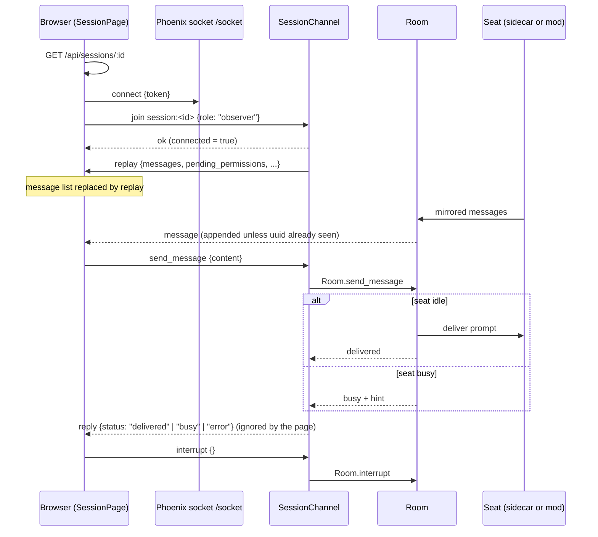

# The seat view

The seat view is the web panel's page for one seat, at the route `/sessions/:id`. It shows the seat's conversation as it streams in, lets you type a message to the seat, interrupt it, and switch its model, and it hosts the permission dialog and question card (documented on [permissions-and-questions.md](permissions-and-questions.md)). It exists so you can watch and steer a Claude Code seat from a browser without being at its terminal.

The page is `web/src/pages/SessionPage.tsx`. The live connection is in `web/src/hooks/useSession.ts` and `web/src/lib/socket.ts`; each message row is drawn by `web/src/components/MessageBubble.tsx`.

## How it works

### Loading the row

On mount the page calls `GET /api/sessions/:id` (through `getSession` in `web/src/api/sessions.ts`, with the stored token as `Authorization: Bearer <token>`). Any non-2xx response, or a network failure, makes the page navigate to `/`. Until the row has loaded the page renders nothing at all. The row supplies the header (title, display title, type) and is the fallback for the model picker.

The browser tab title is set by `useDocumentTitle(session?.title)` to `<title> · Claudiverse`. Before the row loads, and after you leave the page, the title is plain `Claudiverse`.

### The live connection

`getSocket(token)` in `web/src/lib/socket.ts` builds one Phoenix `Socket`. Its URL is `VITE_API_URL` (default `http://localhost:4000`) with the leading `http` replaced by `ws`, plus `/socket`, for example `wss://claudiverse.example/socket`. The token goes in the socket params as `{token}`.

The socket is reused unless its `connectionState()` is `"closed"`. The code deliberately does not test `isConnected()`: that is false while the handshake is still in flight, so a second caller during connect used to build a second socket and abandon the first, which stayed open with its channels subscribed, and every broadcast then arrived twice. Two mounts racing the initial connect happen normally (React StrictMode in development, any second subscriber in production).

`useSession` then joins the channel `session:<id>` with `{role: "observer"}`. Before joining it finds any channel already on the same topic in the socket's `channels` list and removes it with `socket.remove`. `channel.leave()` is asynchronous, so under StrictMode's mount, cleanup, mount sequence the second join would otherwise happen while the first channel was still subscribed, giving two channel objects on one topic and every broadcast delivered to both.

`connected` becomes true when the join is acknowledged (`ok`). A join error is only written to the browser console as `Join error:` plus the payload. On unmount the hook leaves the channel and sets `connected` false.



### Events received

| Event | Payload fields the page uses | Effect |
|---|---|---|
| `replay` | `messages`, `pending_permissions` (optional) | Replaces the whole message list with `messages`, and the pending permission list with `pending_permissions` (or `[]` if absent). |
| `message` | one message object | Appended to the list, unless its `uuid` matches a message already in the list. |
| `permission_request` | a permission request | Appended to the pending permission list. |
| `permission_resolved` | `request_id` | Removes that request from the pending list. |
| `session_ended` | none | Sets `connected` to false. |

The `replay` payload from the server carries more fields (`earlier_count`, `agent_messages`, `agents`, `busy_agents`, `background_tasks`); the web panel reads only the two listed above.

De-duplication is by `uuid` only. A message without a `uuid` is always appended. Content is not used as a key because identical `stream_event` payloads legitimately recur many times in a turn, and de-duplicating on content would drop real data. The check exists as defence against a re-delivery the socket and channel fixes above did not prevent.

### Pushes sent

| Push | Payload | Sent by |
|---|---|---|
| `send_message` | `{"content": "<text>"}` | the composer's Send, the model picker, and the question card |
| `permission_response` | `{"request_id": "<id>", "decision": "allow" \| "deny"}` | the permission dialog |
| `interrupt` | `{}` | the Stop button |

In the web panel, Stop interrupts the current turn; it does not stop the seat (the apps' Stop ends the seat).

All pushes go through the current channel reference; if there is no channel, the push is silently dropped. The page does not attach a reply handler to any push, so it never shows the server's `delivered` / `busy` answer.

### What the server does with them

From `claudiverse_server/lib/claudiverse_server_web/channels/session_channel.ex`:

- Join. Host tokens are refused (`host tokens cannot join seats`). The `role` param defaults to `observer`. If the signed-in user does not own the session the join fails with `{reason: "not_found"}`. An observer join registers nothing with the room (only `sidecar` joins start the room and register the sidecar); it only schedules a replay.
- Replay. Right after the join the server pushes `replay`: the earlier conversation of a resumed seat's previous rows, followed by the room's replay buffer, plus the agent data and `pending_permissions` (the prompts asked before you joined).
- `send_message` (observer role only). The reply is `{status: "delivered"}`, `{status: "busy", hint: <text>}` or `{status: "error", error: "not connected"}`. This is reject-busy: the room accepts the prompt only while the seat is idle; otherwise nothing is delivered and the `hint` is the first 120 characters of the latest assistant text, or `in progress`.
- `interrupt` (observer role only). Forwarded to the room; no reply.
- `permission_response` is covered on [permissions-and-questions.md](permissions-and-questions.md).

How a delivered prompt reaches the seat depends on the seat: through its MCP channel, else its inbox (mod seats), else its sidecar. See [../mod/inbox.md](../mod/inbox.md).

## Configuration

| Setting | Default | Notes |
|---|---|---|
| `VITE_API_URL` | `http://localhost:4000` | Compile-time. Used for REST calls; for the socket it is rewritten from `http` to `ws` and `/socket` is appended. Changing it needs a rebuild (see [build-and-deploy.md](build-and-deploy.md)). |
| `localStorage` key `token` | none | Read by the REST helper for the `Authorization` header. The socket token comes from the auth context. |

There are no per-page settings.

## Interface

### Header

- Back link to `/`.
- Title (`session.title`).
- Display title (`session.display_title`), shown only when it is set and differs from the title.
- `session.type` (`sidecar` or `spawned` in the client's types).
- A dot and the text `Connected` or `Disconnected`, from the channel state.

`session.model` is not shown in the header. The code comment gives the reason that no client reported it, so the server's `sonnet` default appeared for every seat. The server has since started updating the row's `model` from each mirrored assistant message, so that reason is out of date, but until a seat's first reply the row still holds the `sonnet` default. The model is shown in the picker, which uses the seat's latest reply first (below).

### Empty state

While the message list is empty the page shows:

```
Waiting for messages...
Connect Claude with: claude --claudiverse-server ws://localhost:4000
```

The hint is hard-coded and shown verbatim, regardless of your server address. See the mismatch note under Failure modes.

### Message list

The page renders one `MessageBubble` per message, keyed by array index, then any pending permission dialogs (see [permissions-and-questions.md](permissions-and-questions.md)), then scrolls the newest message into view with smooth scrolling whenever the message list changes. (Pending permission requests alone do not trigger the scroll.)

`MessageBubble` decides by the message's `type`:

| `type` | Rendering |
|---|---|
| `stream_event`, `stream_request_start`, `set_in_progress_tool_use_ids` (the `SILENT_TYPES` set) | Nothing. |
| `idle` | Nothing. It is a repeating state flag, and drawing it next to `turn_complete` produced two rules in a row. |
| `agents`, `agent_ended`, `background_tasks` | Nothing. They feed the apps' side panels, which the web panel does not have. |
| `control_request` | Nothing. The permission dialog under the conversation shows the prompt while it waits. |
| `user`, with `isMeta` true | A collapsed block labelled `Tool result` with the first line (first 100 characters) as a peek; the body is the content text. Nothing if the body is blank. These are Claude Code's own notes on the user turn, for example about an image it read. |
| `user`, content array containing `tool_result` blocks | One collapsed block per tool result: summary `Tool result` (or `Tool failed` when `is_error`) plus a first-line peek of up to 100 characters; the body is a preformatted block of the result text, or pretty JSON if the result has no text. |
| `user`, anything else | A user bubble with the text. A string is shown as is; an array has its `text` fields joined with newlines (so an interrupt, `[{type:"text", text:"[Request interrupted by user]"}]`, shows its text); other shapes are JSON-stringified. Nothing is drawn if the text is blank. Images are not rendered as images: an image block has no `text`, so it contributes nothing. |
| `assistant` | One bubble containing, in order, only blocks of type `text`, `thinking` or `tool_use`; if there are none the row is empty. `text` is rendered as Markdown with `react-markdown` and `remark-gfm` (raw HTML is not evaluated). `thinking` is a collapsed `Thought` block. A `tool_use` named `AskUserQuestion` whose input has a non-empty `questions` array of objects is drawn as a question card (see [permissions-and-questions.md](permissions-and-questions.md)). Any other `tool_use` is a collapsed block whose summary is the tool name followed by two spaces and its most identifying input (the first present of `file_path`, `path`, `command`, `pattern`, `query`, `url`, `prompt`), whitespace collapsed and cut to 80 characters with an ellipsis; opening it shows the input as pretty JSON. With no such argument the summary is the bare tool name. |
| `attachment` | Dropped entirely when the attachment type is `date` or `total_tokens_reminder`. Otherwise a collapsed block whose body is the attachment as pretty JSON. The summary is `Context: <file names>` (last path segment of each file) when the attachment lists files; otherwise a label by attachment type: `session_context` and `context` give `Environment context`, `prompt_snapshot` and `systemPrompt` give `System prompt`, `deferred_tools_delta` gives `Tool availability changed`, `mcp_servers` gives `MCP servers`, `instructions` gives `Instructions`, `remote_session_change` gives `Remote control session changed`, and any other type shows its raw type name. |
| `result` | A bubble labelled `Done` when `subtype` is `success`, otherwise `Error`, followed by `result` rendered as Markdown if it is not null. |
| `turn_complete` | A horizontal rule (the turn divider). |
| `post_turn_summary` | Nothing when `value` is null or empty. Otherwise a line labelled `recap` followed by the value. |
| `system`, `status` | A small line `system: <message as JSON>` or `status: <message as JSON>`. |
| anything else | A small line `[<type>]`, so an unknown type is visible rather than silently dropped. |

### Composer

- A text input with the placeholder `Send a message to Claude...`.
- Send (form submit): disabled while disconnected or when the input is blank after trimming. It sends the trimmed text as `send_message` and clears the input.
- Stop: sends `interrupt` with `{}`. Disabled while disconnected. Its tooltip is `Interrupt`.
- The input is also disabled while disconnected.

### Model picker

A `Model` select under the composer, disabled while disconnected. Its choices (`MODEL_CHOICES`):

| Label | `id` (sent) | `match` prefix |
|---|---|---|
| Opus 5 (1M) | `claude-opus-5[1m]` | `claude-opus-5` |
| Fable 5.1 (1M) | `claude-fable-5.1[1m]` | `claude-fable-5` |
| Sonnet | `sonnet` | `claude-sonnet` |
| Haiku | `haiku` | `claude-haiku` |

The `[1m]` suffix is kept in the `id` because dropping it would silently switch the seat to the smaller context window. `match` is a separate string because an assistant message reports the model without the suffix (for example `claude-opus-5`), so matching on `id` would never resolve.

The displayed value is `modelAlias(runningModel)`. `runningModel` is the `message.model` of the latest `assistant` message in the list, falling back to `session.model` from the row loaded at page open, then to nothing. `modelAlias` lowercases the reported model and picks the first choice whose `match` is a prefix of it (so a point release such as `claude-opus-5-1` still resolves), or whose lowercased `id` equals it. Because the value follows the seat's latest reply, it shows what is running, not what you last clicked, and it follows a `/model` typed in the terminal within a turn.

If no choice matches, an extra first option is shown with the raw reported model id as its text (or `unknown` if there is none), so the control never claims a model the seat is not running.

Choosing an option sends `send_message` with `{"content": "/model <id>"}`, for example `/model sonnet`. Nothing else happens client-side: the picker changes only when a later assistant reply reports a new model.

## Failure modes and troubleshooting

- Blank page. The row failed to load (or is still loading). On failure you are redirected to the dashboard; check that you are logged in and that the seat id exists and belongs to your account.
- `Disconnected`, with the composer, Stop and model picker disabled. The channel join has not succeeded, failed (see `Join error:` in the browser console; `not_found` means the seat is not yours, and host tokens cannot join), or the server sent `session_ended`. The page does not rejoin after `session_ended`; reload it.
- Sending while the seat is busy. The server rejects the message (`status: "busy"`), but the page ignores the reply, so the text disappears from the input and nothing is delivered and nothing is shown. Wait for the seat to go idle and send again.
- Messages that are doubled. Should not happen: the page reuses one socket, removes stale channels, and drops repeated `uuid`s. A message with no `uuid` that is re-delivered would still be duplicated.
- The model picker does not work on a mod seat. This is a mismatch. The picker sends the text `/model <id>` as an ordinary `send_message`. The server's channel does not filter it, so for a mod seat it is queued in the seat's inbox and handed to the mod's `deliver` function in `mods/claudiverse-seat/hooks/register.ts`. `deliver` runs only `/compact` from the inbox; any other slash command is refused with the seat's log line `claudiverse: /model from the inbox was not run (only /compact is)`, and the seat is reported idle again. The picker therefore does nothing on a mod seat, and since it reflects the latest assistant reply, it keeps showing the old model. The server's own code for the API route (`notify_controller.ex`) likewise lists only `compact` as an inbox command. For a patched sidecar seat the text goes to the sidecar as `remote_input`; this page does not establish whether that runs `/model`.
- Empty-state hint is wrong. This is a mismatch. The hint `claude --claudiverse-server ws://localhost:4000` appears only in `SessionPage.tsx` and in the project's old `PLAN.md` (which describes the flag as a planned addition to a patched Claude CLI). No such flag exists in the seat mod, the orchestrator scripts or the server. Seats are started as described in the [mod pages](../mod/mirroring.md) and by the host agent, not with this flag.
- Images in a user turn are not shown (see the message table).
- Pending permission requests do not cause an auto-scroll.

## Related pages

- [Web panel reference](README.md)
- [Setup, login and the session token](setup-and-login.md)
- [Dashboard](dashboard.md)
- [Permissions and questions in the web panel](permissions-and-questions.md)
- [Accounts page](accounts.md)
- [Forum page](forum.md)
- [Building and serving the panel](build-and-deploy.md)
- [../mod/inbox.md](../mod/inbox.md)
- [../mod/mirroring.md](../mod/mirroring.md)
- Server: [HTTP mirror, inbox long-poll and liveness](../../server/mirror-inbox-liveness.md), [Sessions and Rooms](../../server/sessions-and-rooms.md)
- Runners and tools: [cvctl: the orchestrator CLI](../../runners/cvctl.md), [cv-mcp: seat, ping and question tools](../../runners/mcp-seats.md)
- Host agent: [Seat control](https://github.com/Promises/claudiverse-host-agent-oss/blob/main/docs/reference/seat-control.md)
- Android: [Seat controls](https://github.com/Promises/claudiverse-apps/blob/main/docs/android/seat-controls.md), [Seat view](https://github.com/Promises/claudiverse-apps/blob/main/docs/android/seat-view.md)
- Mac: [Seat view](https://github.com/Promises/claudiverse-apps/blob/main/docs/mac/seat-view.md), [Transcript](https://github.com/Promises/claudiverse-apps/blob/main/docs/mac/transcript.md)

## Source

- `web/src/pages/SessionPage.tsx`
- `web/src/hooks/useSession.ts`
- `web/src/hooks/useDocumentTitle.ts`
- `web/src/lib/socket.ts`
- `web/src/api/sessions.ts`
- `web/src/components/MessageBubble.tsx`
- `claudiverse_server/lib/claudiverse_server_web/channels/session_channel.ex`
- `claudiverse_server/lib/claudiverse_server/sessions/room.ex`
- `mods/claudiverse-seat/hooks/register.ts`
