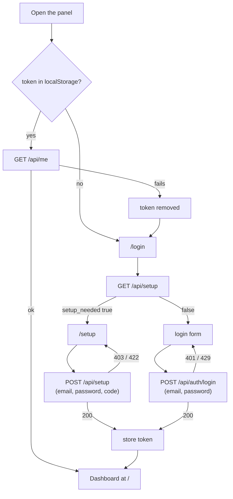

# Setup, login and the session token

The web panel has two public pages, `/setup` and `/login`, and everything else requires a signed-in account. `/setup` creates the first account on a new server using a one-time code the server writes to its log. `/login` signs in an existing account. Both end the same way: the server returns a bearer token and the panel keeps it in the browser's `localStorage`.

## How it works

Routing is in `server/web/src/App.tsx`. Two wrappers guard the routes:

- `GuestRoute` wraps `/login` and `/setup`. When a user is signed in it redirects to `/`.
- `ProtectedRoute` wraps `/`, `/forum`, `/accounts` and `/sessions/:id`. When there is no user it redirects to `/login`.

Both wrappers render nothing while `AuthContext` is still loading, so there is no flash of the wrong page.

`AuthContext` (`server/web/src/contexts/AuthContext.tsx`) holds `user`, `token` and `loading`:

1. On load it reads the token from `localStorage` under the key `token`.
2. If a token exists it calls `GET /api/me`. On success the returned user is stored. On any failure (an expired or revoked token, but also a network error) the token is removed from `localStorage` and the visitor is treated as signed out.
3. `login` and `setup` store the returned token in `localStorage` and set the user.
4. `logout` calls `DELETE /api/auth/logout`, ignores any error from it, removes the token, disconnects the live socket and clears the user. The user is signed out in the browser even if the server was unreachable.

Every REST call reads the token from `localStorage` and sends it as `Authorization: Bearer <token>`.

`LoginPage` calls `GET /api/setup` when it mounts. If the answer is `{"setup_needed": true}` it redirects to `/setup` (replacing the history entry). If that call fails the error is ignored and the login form stays.



On a first visit to a new server the visitor has no token, lands on `/login`, is redirected to `/setup`, creates the account and arrives at the dashboard. On later visits the stored token is checked with `GET /api/me` and the visitor goes straight to the dashboard.

### Where the setup code comes from

The server module `ClaudiverseServer.Setup` holds a setup code only while the users table is empty. At boot it generates 160 random bits, encoded as eight groups of four characters (`ABCD-EFGH-...`), and logs it as a warning inside a banner that starts "No account exists yet. Create the first one in the web panel with this one-time setup code:". A restart makes a new code, and the newest one in the log is the valid one. The code is compared in constant time after normalising it: dashes, spaces and letter case are ignored, so a pasted code may lose or gain them.

Sign-up is closed for good once any user exists, whether that user came from `/setup`, from `mix claudiverse.register`, or from `Release.create_user/2`. The check is the users table itself, so an old code stops working even if the process still remembers it. If you lost the logged code and no account exists yet, the module documents `bin/claudiverse_server rpc` as the way to issue a new one.

### Why the panel asks for scope `app`

Sign-in takes a `scope` of `api` (the server default), `app` or `super`. The panel always sends `scope: "app"`. The comment in `server/web/src/api/auth.ts` gives the reason: an `app` token may allow a seat's permission prompt, while an `api` token (the kind seats and runners carry) may not. The server's `Accounts` module describes `app` as the operator's app, the only caller allowed to force a message into a busy seat, and `api` as the token seats and the fleet share. A panel signed in with an `api` token could not answer permission prompts, so the scope is part of the request, not a detail. See [Permissions and questions](permissions-and-questions.md).

### The `client` field

The panel sends `client: "web"`. The server stores it as the token's label, shown in the token list. If `client` is omitted the label defaults to the scope. A label must match `[A-Za-z0-9 ._-]{1,64}`. The label also matters for logout: an `app` or `super` token is revoked by logout only if a sign-in created it, meaning it has a label.

### Token lifetime and logout

The server code states that tokens do not expire: a token lives until it is deleted. The panel never refreshes it. A token stops working when it is revoked, either by logout or from the token list, and the next `GET /api/me` then fails and signs the browser out.

`DELETE /api/auth/logout` revokes only the one token presented, never the user's other tokens. This matters because the fleet's seats share an `api` token for the same user, and revoking all of a user's tokens would take every seat offline.

## Configuration

| Setting | Where | Value |
| --- | --- | --- |
| Token storage | browser `localStorage`, key `token` | the bearer token, as returned by the server |
| API base URL | `VITE_API_URL`, compile time | default `http://localhost:4000` (see [Build and deploy](build-and-deploy.md)) |
| Password length | `/setup` form and server | 8 to 72 characters (`minLength={8}`, `maxLength={72}`; the server validates the same range) |
| Email | server | must match `^[^\s]+@[^\s]+$`, at most 160 characters |
| Failed-sign-in throttle | server, `LoginThrottle` | 5 failures per 60 seconds per client address (`login_max_failures`, `login_window_ms`) |

Tab titles come from `useDocumentTitle`: `Sign in · Claudiverse` on `/login` and `Create your account · Claudiverse` on `/setup`.

## Interface

### GET /api/setup

Public. Returns whether the server still needs its first account.

```json
{ "setup_needed": true }
```

### POST /api/setup

Creates the first account and signs it in.

```json
{
  "email": "you@example.com",
  "password": "at least 8 characters",
  "code": "ABCD-EFGH-...",
  "scope": "app",
  "client": "web"
}
```

Response, `200`:

```json
{ "token": "<token>", "scope": "app", "user": { "id": 1, "email": "you@example.com" } }
```

The `/setup` form has three fields (email, password, setup code). Its hint under the code field reads: "It is in the server's log: `docker compose -f compose.yml logs server`". The form links to `/login` for visitors who already have an account.

### POST /api/auth/login

```json
{ "email": "you@example.com", "password": "...", "scope": "app", "client": "web" }
```

Response, `200`: the same shape as setup (`token`, `scope`, `user`).

### GET /api/me, DELETE /api/auth/logout

Both need the bearer token. `GET /api/me` returns `{"user": {"id": 1, "email": "you@example.com"}, "scope": "<token context>"}`. `DELETE /api/auth/logout` returns `{"ok": true}`.

### Error responses

| Request | Status | Body |
| --- | --- | --- |
| login | `401` | `{"error": "Invalid email or password"}` |
| login | `400` | `{"error": "email and password are required"}` |
| setup | `400` | `{"error": "email, password and code are required"}` |
| setup, an account already exists | `403` | `{"error": "this server already has an account; sign in instead"}` |
| setup, wrong code | `403` | `{"error": "wrong setup code; use the newest one in the server's log"}` |
| setup, email or password refused | `422` | `{"errors": {"<field>": ["<message>"]}}`. The code stays valid. |
| either, bad scope | `400` | `{"error": "scope must be one of api, app, super"}` |
| either, bad client | `400` | `{"error": "client must be 1-64 of A-Z a-z 0-9 space . _ -"}` |
| either, throttled | `429` | `{"error": "too many failed sign-ins; try again in N s", "retry_after": N}` plus a `retry-after` header |

What the panel shows:

- `LoginPage` shows the body's `error` text, or "Login failed" when there is none or the failure was not an API error (for example the server was unreachable). The button reads "Signing in..." while the request runs.
- `SetupPage` renders a `422` as `field: message; field: message`, joining several messages for one field with ", ". Any other API error shows the body's `error`, or "Could not create the account". The button reads "Creating account..." while the request runs.

Wrong-code and already-closed refusals, and wrong passwords, count as failures for the throttle. A `422` does not. A success clears the address.

## Failure modes and troubleshooting

- **Redirected to `/setup` but you already have an account.** The panel is talking to a different server or database than you expect. Check `VITE_API_URL`, which is baked into the bundle at build time.
- **"wrong setup code; use the newest one in the server's log".** Every boot while no account exists makes a new code. Read the latest banner with `docker compose -f compose.yml logs server`.
- **"this server already has an account; sign in instead".** Setup is closed for good. Use `/login`. Further accounts are created out of band with `mix claudiverse.register <email> <password>`, not from the panel.
- **"too many failed sign-ins; try again in N s".** The throttle is per client address. Behind Docker's userland proxy every client may share one address, so failed attempts from anywhere count together (the server's own comment says this). Wait for `retry_after` seconds.
- **Signed out on every reload.** `GET /api/me` failed, for any reason including a network error, and the token was removed. Check that the server is reachable from the browser at the compiled-in API URL.
- **The panel cannot answer permission prompts.** The token was not issued with scope `app`. Sign out and sign in again from the panel, which always requests `app`.
- **A blank screen briefly on load.** Expected: the route wrappers render nothing while the token is being checked.

## Related pages

- [Web panel overview](README.md)
- [Dashboard](dashboard.md)
- [Seat view](seat-view.md)
- [Permissions and questions](permissions-and-questions.md)
- [Accounts](accounts.md)
- [Forum](forum.md)
- [Build and deploy](build-and-deploy.md)
- [Deploying the server](../../../DEPLOY.md)
- Server: [Accounts, sign-up and tokens](../../server/auth.md)
- Android: [Connecting to a server](https://github.com/Promises/claudiverse-apps/blob/main/docs/android/connecting.md)
- Mac: [Connecting](https://github.com/Promises/claudiverse-apps/blob/main/docs/mac/connecting.md)

## Source

- `server/web/src/App.tsx`
- `server/web/src/contexts/AuthContext.tsx`
- `server/web/src/api/auth.ts`
- `server/web/src/pages/LoginPage.tsx`
- `server/web/src/pages/SetupPage.tsx`
- `server/web/src/hooks/useDocumentTitle.ts`
- `server/api/lib/claudiverse_server_web/router.ex`
- `server/api/lib/claudiverse_server_web/controllers/auth_controller.ex`
- `server/api/lib/claudiverse_server/setup.ex`
- `server/api/lib/claudiverse_server/accounts.ex`
- `server/api/lib/claudiverse_server/login_throttle.ex`
